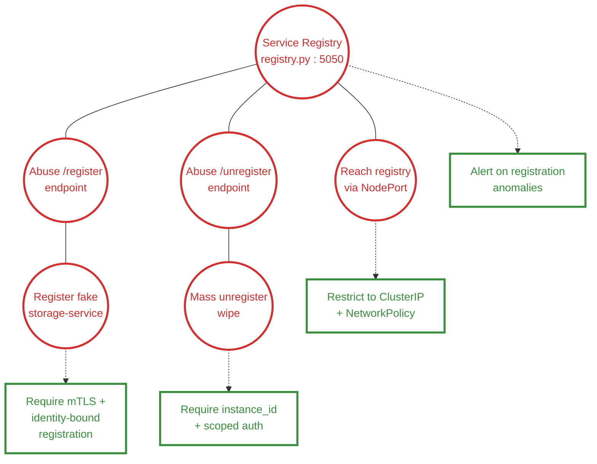
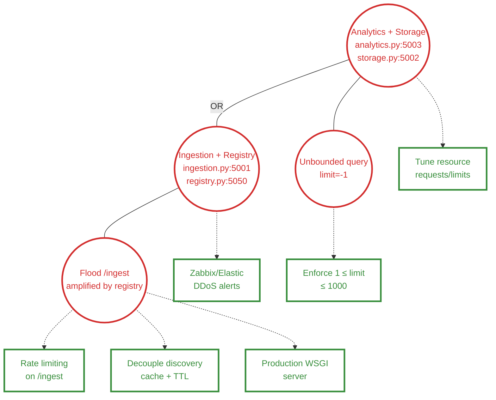
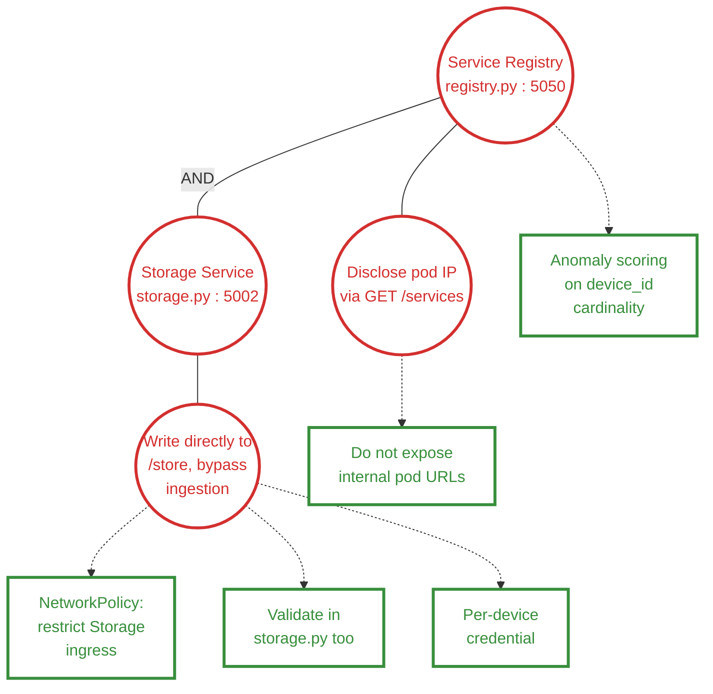

# Attack-Defense Trees — SSLE Projeto 1

Notação seguida de Lesson04-Monitoring (slide 25, Kordy et al.):
- ◯ círculo vermelho = attack/target node (o(s) serviço(s) atacado(s) é
  o topo da hierarquia, tal como "Bank Account" no exemplo dos autores
  originais)
- ▭ retângulo verde = defense node (countermeasure)
- linha sólida = disjunctive refinement (OR)
- linha sólida rotulada "AND" = conjunctive refinement
- linha pontilhada = countermeasure, ligada ao nó específico que mitiga

---

## ADTree 1 — Service Registry (alvo único no topo)

---

## ADTree 2 — DDoS (2 serviços-alvo no topo, OR)

---

## ADTree 3 — Botnet/Fraude (2 serviços-alvo no topo, AND)

