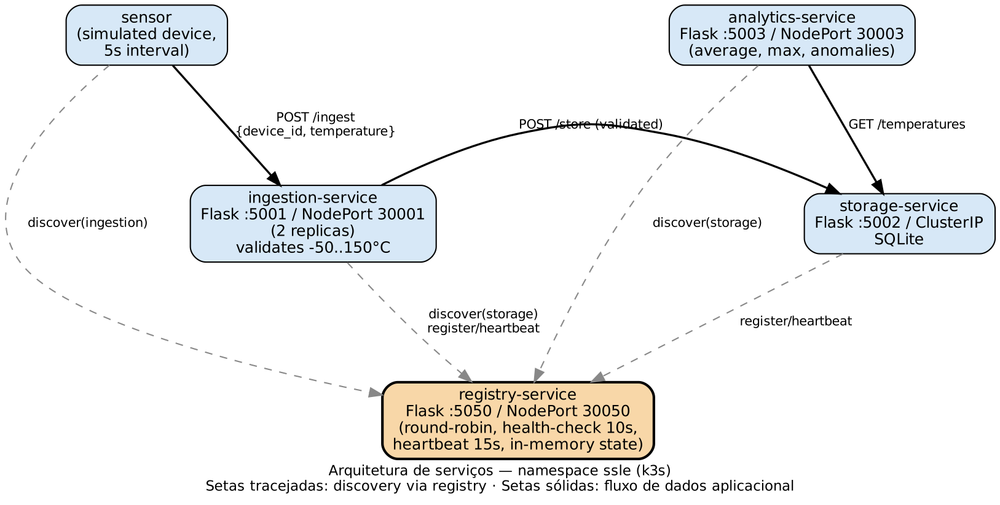
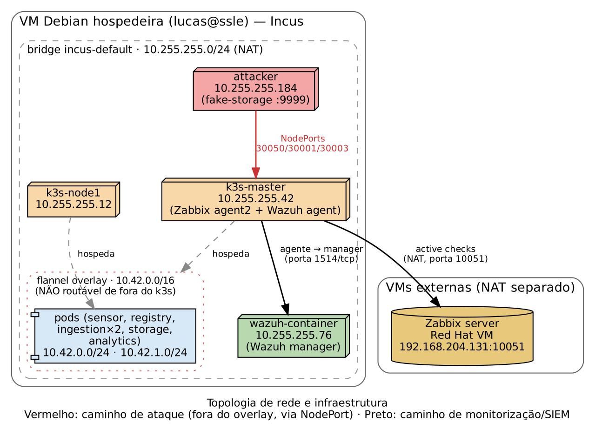
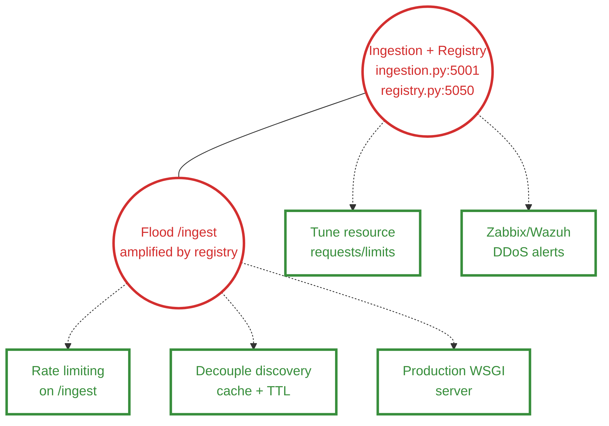
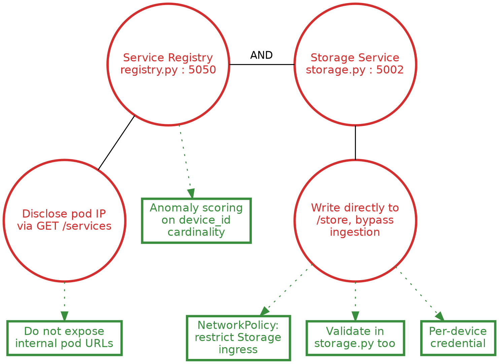

# SSLE — Projeto 1
## Design and Run a Service-Based Architecture that Scales

**Autor:** Lucas Rebelo
**Entrega:** 22 de novembro de 2026

Estrutura conforme `Projeto.pdf`, slide 4 ("Classic article/thesis structure"):
Introduction · Relevant State of the Art · Service Architecture Used ·
Risk Management and Mitigation · Approach to three threats considered ·
Evaluation of the solution's approaches and scalability · Conclusions

---

## 1. Introduction

Este relatório documenta o desenho, implementação e análise de segurança de
uma arquitetura SOA de pequena escala: um pipeline de ingestão, armazenamento
e análise de dados de sensores, construído sobre os Guiões 1 e 2 da
disciplina e empacotado num cluster Kubernetes (k3s) dentro de contentores
Incus. O objetivo do Projeto 1 tem duas componentes. A primeira é desenhar e
correr uma arquitetura orientada a serviços capaz de escalar, com um esquema
de identificação e localização hierárquico adequado a ambientes de larga
escala. A segunda é analisar, explorar na prática e propor mitigação para
três ameaças do syllabus da cadeira (route/signals hijacking, denial-of-service
massivo e botnets/fraude de dados), completando em cada uma o ciclo
exploração, deteção, resposta e post-mortem.

O relatório organiza-se da seguinte forma. A Secção 2 enquadra os conceitos
teóricos relevantes: SOA, FCAPS, monitorização de larga escala, SIEM e
Attack-Defense Trees. A Secção 3 descreve a arquitetura de serviços
implementada. A Secção 4 apresenta a metodologia de gestão de risco, com a
superfície de ataque e as três ADTrees construídas. A Secção 5 detalha, para
cada uma das três ameaças escolhidas, a sua exploração prática, deteção e
resposta. A Secção 6 avalia a escalabilidade da solução, e a Secção 7 fecha
com as principais conclusões e limitações identificadas.

---

## 2. Relevant State of the Art

Esta secção enquadra os conceitos teóricos sobre os quais o restante
relatório assenta: a arquitetura orientada a serviços como padrão de design,
o modelo de gestão de falhas FCAPS e a sua lacuna face a eventos de
segurança, as abordagens de monitorização de larga escala consideradas, e a
metodologia de modelação de ameaças (Attack-Defense Trees) usada na Secção 4.

### 2.1 Service-Oriented Architecture / Microservices

Uma arquitetura orientada a serviços (SOA) decompõe um sistema num conjunto
de serviços independentes, fracamente acoplados, que comunicam através de
contratos bem definidos em vez de partilharem estado ou memória. Os papéis
clássicos de uma SOA (o *provider*, que presta o serviço; o *consumer*, que o
consome; e o *broker/registry*, o intermediário que permite a descoberta
mútua, desacoplando consumidores de endereços fixos de providers) estão
todos representados na arquitetura deste projeto. O Service Registry assume
o papel de broker, enquanto os restantes quatro serviços alternam entre
provider e consumer consoante a direção do fluxo de dados: o Storage, por
exemplo, é provider para o Ingestion e para o Analytics, mas consumer do
Registry.

A propriedade de *discoverability*, em que um serviço anuncia a sua presença
e localização sem exigir configuração estática nos seus consumidores, é o
que permite a uma SOA escalar horizontalmente (múltiplas réplicas de um
mesmo serviço, descobertas de forma transparente) e geograficamente
(serviços distribuídos por múltiplos nós ou regiões). É também, como se
discute nas Secções 4 e 5.1, o ponto de maior concentração de risco do
sistema, já que a descoberta depende inteiramente da integridade do broker.

### 2.2 FCAPS e Fault Management

Modelo FCAPS (ISO/IEC 7498-4), com foco no workflow de Fault Management:
Detecting → Diagnosing and Isolating → Correlating → Resolution/Mitigation
→ Post-Mortem. O syllabus é explícito quanto à lacuna que este modelo deixa:
*"Fault Management within FCAPS does not deal with security events (i.e., at
least explicit security events)"*. É essa lacuna que motiva a integração com
um SIEM, discutida de seguida.

### 2.3 SIEM e Attack-Defense Trees

Um SIEM (Security Information and Event Management) combina as funções de
*log management*, *Security Information Management* (SIM: armazenamento e
análise histórica de logs) e *Security Event Management* (SEM: correlação e
deteção em tempo quase real), tipicamente completadas por normalização de
eventos de múltiplas fontes, motores de correlação, capacidades de resposta
a incidentes e relatórios de compliance. Neste projeto, a função de SIEM é
cumprida pelo Wazuh: os agentes recolhem os logs dos nós (log management), o
indexer guarda-os e permite a análise histórica (SIM), e o motor de regras e
decoders do manager faz a normalização e a correlação de eventos em tempo
quase real (SEM). A capacidade nativa de *active response* permite associar
a cada deteção uma ação automática de contenção, usada para as três ameaças
tratadas na Secção 5.

As Attack-Defense Trees (ADTrees) modelam um cenário de ameaça como uma
hierarquia. O nó raiz representa o ativo ou objetivo visado; cada nível
seguinte refina esse objetivo em sub-objetivos ou técnicas mais específicas,
por disjunctive refinement (qualquer um basta) ou conjunctive refinement
(todos são necessários); e nós de defesa (countermeasures) ligam-se ao nó de
ataque específico que mitigam. As três ADTrees construídas para este projeto
(Secção 4.2) seguem esta notação, com os serviços-alvo no topo da hierarquia.

---

## 3. Service Architecture Used

### 3.1 Visão geral

Sistema SOA baseado nos Guiões 1 e 2 da disciplina: 5 microsserviços Flask
(Service Registry, Ingestion, Storage, Analytics, Sensor), empacotados como
imagens Docker e orquestrados num cluster k3s (`k3s-master` + `k3s-node1`)
dentro de contentores Incus.

```
sensor → [discover via registry] → ingestion → [discover via registry] → storage
                                                                              ↑
                                                                        analytics
                                                                     (discover via registry)
```



### 3.2 Identificação e naming hierárquico (slide 7)

Esquema implementado em `common.py`:

```
<país>.<região>.<datacenter>.<rack>.<node>.<serviço>.<instância>
ex: pt.centro.dc-incus.k3s.k3s-node1.storage-service.storage-f6f4dbd-lvwth
```

Propaga-se como campo `location` no Service Registry:
- **Localização física/lógica:** país → região → datacenter → rack → node.
- **Delegação geográfica:** campos independentes por nível.
- **Localização rápida da origem de um incidente:** o `instance_id` é a
  chave de correlação partilhada entre o registry, os logs e o SIEM.

### 3.3 Topologia de rede e infraestrutura

- VM Debian (`lucas@ssle`) hospeda o Incus.
- Bridge `incus-default`, NAT, rede `10.255.255.0/24`.
- Cluster k3s: `k3s-master` (10.255.255.42) + `k3s-node1`.
- Serviços expostos via NodePort: registry (30050), ingestion (30001),
  analytics (30003); storage em ClusterIP.
- Sem NetworkPolicies no namespace `ssle`.



### 3.4 Integração com monitorização/SIEM

A recolha de monitorização e segurança assenta em dois agentes
independentes, ambos instalados no nó `k3s-master` e a comunicar com os
respetivos servidores (Zabbix, Wazuh) através da mesma rota NAT já usada
para o tráfego de ataque das PoCs (Secção 3.3):

- **Zabbix agent2**, em modo ativo (`ServerActive`), com itens do tipo
  `Zabbix agent (active)` que leem ficheiros de log gerados localmente
  (`log[]`) a partir do stream contínuo de `kubectl logs -f` de cada
  serviço relevante (`registry-stream.log`, `ingestion-stream.log`),
  geridos como serviços `systemd` dedicados.
- **Agente Wazuh**, ligado ao manager em `10.255.255.76:1514/tcp`, a
  monitorizar os mesmos ficheiros de log (`<localfile>`), com regras
  locais (`etc/rules/local_rules.xml`) e active-response associado por
  regra.

A correlação FCAPS↔segurança foi obtida fazendo disparar, para a mesma
janela temporal, um sinal Zabbix (operação) e um sinal Wazuh (segurança) a
partir da mesma fonte de log. Isto foi confirmado empiricamente para as
Ameaças 1 e 2 (Secções 5.1.1 e 5.2.1).

---

## 4. Risk Management and Mitigation

### 4.1 Attack surfaces

A superfície de ataque do sistema organiza-se em três camadas, cada uma com
um conjunto distinto de pontos de exposição.

**Camada de aplicação.** Os cinco serviços expõem, no total, nove endpoints
HTTP, nenhum deles protegido por autenticação ou autorização. O Service
Registry é o ponto de maior concentração de risco: é o único componente que
todos os outros quatro serviços consultam cegamente (`discover()`,
`common.py`), e os seus endpoints de escrita (`/register`, `/unregister`)
aceitam qualquer `name`/`url`/`instance_id` declarado pelo cliente, sem
qualquer verificação de identidade. O Storage Service, apesar de pensado
como acessível apenas através do Ingestion, expõe `/store` sem validação
própria. É uma segunda camada de confiança implícita que, como se demonstra
em 5.3, acaba por ser trivialmente contornável.

**Camada de orquestração.** Três dos cinco serviços (`registry`, `ingestion`,
`analytics`) estão expostos como `type=NodePort`, tornando-os alcançáveis em
qualquer nó do cluster a partir de qualquer ponto com reachability de rede,
sem qualquer `NetworkPolicy` a restringir o tráfego interno entre pods no
namespace `ssle`. O `storage`, embora configurado como `ClusterIP` (pensado
para só ser alcançável de dentro do cluster), tem o seu IP de pod divulgado
publicamente via `GET /services` do registry, o que anula na prática essa
barreira, como fica confirmado na PoC da Ameaça 3 (Secção 5.3).

**Camada de rede/infraestrutura.** Duas fronteiras de NAT separam o atacante
do sistema, consoante o ponto de partida. A bridge Incus (`incus-default`,
NAT) isola a rede `10.255.255.0/24` da rede das VMs do mini SOC, e o
`externalTrafficPolicy: Cluster` por omissão dos NodePorts introduz SNAT,
mascarando o IP de origem real de um atacante externo nos logs da
aplicação. A rede overlay do flannel (`10.42.0.0/16`), por sua vez, não é
routável a partir de um contentor Incus genérico fora do cluster. Esta
barreira adicional foi confirmada empiricamente durante a PoC da Ameaça 3
(Secção 5.3) e reduz o conjunto de atacantes realistas àqueles com execução
de código dentro da rede overlay do cluster.

Para além destas duas vulnerabilidades (o registo e a remoção não
autenticados no Service Registry, e a divulgação do IP do pod do Storage via
`GET /services`), duas outras merecem destaque por terem sido confirmadas
empiricamente nas PoCs da Secção 5, e não apenas inferidas da leitura do
código.

Os limites de CPU reduzidos impostos a cada pod (250m, Secção 3.3),
partilhados entre todos os serviços do namespace `ssle`, amplificam o
impacto de qualquer carga repetida. A PoC da Secção 5.2 mostrou que a mesma
sequência de pedidos produz taxas de falha muito diferentes (5.5% a 76.5%)
consoante o estado de saturação prévio do sistema: o limite de recursos,
pensado para conter o blast radius de um pod isolado, acaba por tornar o
sistema mais sensível a ataques repetidos, não menos.

Por fim, o próprio mecanismo de resposta automática (active-response) pode
tornar-se um vetor de indisponibilidade. A Secção 5.1.2 mostra uma versão
inicial da regra de deteção a disparar sobre tráfego legítimo (heartbeats
normais do Storage), gerando um `DELETE /unregister` automático sobre o
próprio sistema a cada 15 segundos: um caso real e medido de autodenegação
de serviço causada pela própria camada de defesa, só corrigido depois de a
regra passar a distinguir a origem do registo. Vale notar que esta
distinção, tal como qualquer alternativa que verificasse antes o campo
`location` em vez do nó embutido no `instance_id`, é necessariamente
heurística e não definitiva: ambos os campos são declarados livremente pelo
cliente no `POST /register` (Secção 5.1), sem qualquer prova de identidade
por trás. Um atacante que conheça o critério de deteção pode simplesmente
declarar um `instance_id` ou uma `location` que passem no teste. A deteção
baseada em padrões de conteúdo reduz o conjunto de atacantes não
sofisticados que conseguem passar despercebidos, mas só a mitigação com
`mTLS` e registo ligado à identidade do certificado (proposta na ADTree da
Secção 4.2) fecha esta classe de bypass de forma definitiva.

### 4.2 Attack and Defense Trees

Metodologia: com nós de
ataque (círculo vermelho), nós de defesa (retângulo verde), disjunctive e
conjunctive refinement, e countermeasures. As três ADTrees construídas para
as ameaças da secção 5 estão incluídas diretamente nas Secções 5.1, 5.2 e
5.3, e disponíveis também em `adtrees-ssle-projeto1.md` (Anexo C).

### 4.3 Large-scale system monitoring

O esquema de naming hierárquico (Secção 3.2) é a chave de correlação
partilhada entre as três fontes de dados do sistema: o campo
`instance_id`/`location` tal como declarado no Service Registry, o nome do
host monitorizado no Zabbix (`ssle-k3s-cluster`) e o campo `agent.name` nos
eventos do Wazuh. Isto permite, em princípio, localizar rapidamente a
origem de um incidente a partir de qualquer uma das três fontes: um alerta
de segurança no Wazuh aponta para o mesmo `k3s-master`/nó que o item
correspondente no Zabbix.

Na prática, a análise de causa raiz à escala fica demonstrada não por um
motor de correlação central, mas pela correlação temporal direta
entre os dois sistemas. Para as Ameaças 1 e 2, o mesmo evento de origem (um
`POST /register` malicioso, um pico de `POST /ingest`) é detetado de forma
independente pelo Zabbix e pelo Wazuh dentro da mesma janela de poucos segundos (Secções 5.1.1, 5.2.1).
Isto basta, a esta escala de demonstração, para confirmar a causa de um
incidente sem ambiguidade, mas não escalaria sem um mecanismo de correlação
automática dedicado para um número maior de nós ou sites, limitação que fica
documentada na Secção 7.

### 4.4 Priorização de mitigação

Das três ameaças selecionadas (secção 5), duas (Hijacking, DDoS) apresentam
risco estrutural elevado por serem exploráveis num único passo. A terceira (Botnet/Fraude) depende de uma cadeia de dois passos
obrigatórios: divulgação do IP do pod seguida de
escrita direta. Uma única mitigação de baixo custo, impedir a divulgação de
URLs internos no registry, neutraliza o ataque completo, sem necessidade das
mitigações mais caras, como uma credencial por dispositivo. Esta observação
informa a ordem de prioridade de implementação: as mitigações de baixo
esforço e alto impacto devem ser priorizadas primeiro, independentemente da
ameaça a que pertencem. Por exemplo, `Do not expose internal pod URLs`
elimina, por si só, o vetor mais barato de fechar entre as
três ameaças, antes de se avançar para mitigações de maior esforço como
mTLS (Hijacking) ou credenciais por dispositivo (Botnet/Fraude).

---

## 5. Approach to Three Threats Considered in the Course Syllabus

Ameaças escolhidas: **Route and signals
hijacking**, **Massive denial-of-service disruptions**, **Botnets**
(combinado com Fraud/Reputation Systems). A combinação
dos três últimos itens do syllabus numa só ameaça justifica-se pela
arquitetura do sistema: o mesmo vetor de exploração (escrita direta e não
autenticada no Storage, Secção 5.3) serve em simultâneo para simular uma
frota forjada de dispositivos (Botnets), falsificar a reputação/confiabilidade
dos dados reportados por `device_id` (Reputation Systems) e envenenar os
outputs analíticos consumidos a jusante (Fraud). Para cada ameaça, a
estrutura segue os seis pontos de discussão exigidos pelo enunciado do
projeto: descrição da ameaça, relevância para o sistema, forma de
exploração, ações de monitorização/mitigação relevantes, resposta adotada e
post-mortem da PoC.

### 5.1 Ameaça 1 — Route/Signals Hijacking

- **Descrição da ameaça:**
  Explora a ausência de autenticação no Service Registry próprio (API REST
  em Flask, porta 5050/NodePort 30050). Um atacante regista um endpoint
  malicioso como "storage-service" (`registry.py`, `/register`), fazendo com
  que a descoberta por round-robin encaminhe uma parte do tráfego para o
  atacante (interceção/adulteração de dados).

- **Porque é relevante para o sistema?**
  O Service Registry é o único ponto de confiança de que todos os outros
  componentes dependem cegamente: Sensor, Ingestion, Storage e Analytics
  resolvem-se mutuamente apenas através dele (`discover()` em `common.py`).
  Comprometer este único componente compromete todo o fluxo de dados,
  tornando-o no alvo de maior valor em toda a arquitetura.

- **Como pode ser explorada?**
  - **Vetor de Ataque 1 — Registo não autenticado de uma instância maliciosa
    de storage-service:** `POST /register` aceita campos
    `name`/`url`/`instance_id`/`location` arbitrários, sem qualquer
    autenticação. Um atacante regista uma instância chamada
    `storage-service` a apontar para um endpoint controlado por ele. O
    balanceador round-robin do registry (`get_service()`) passa então a
    encaminhar uma fração de todas as consultas a `storage-service` para o
    atacante, possibilitando a interceção de dados e a falsificação de
    metadados de localização/geografia.
  - ADTree: `adtrees-ssle-projeto1.md`, árvore 1.


- **Ações/métricas relevantes de monitorização e mitigação:**
  - Exigir TLS mútuo e registo ligado à identidade: o CN do certificado do
    cliente tem de corresponder ao `name` registado, o que fecha o Vetor de
    Ataque 1.
  - Alertar sobre anomalias de registo: monitorizar sobreposições de
    registo ou campos de localização inconsistentes com as regiões de
    implementação conhecidas.
  - Métricas concretas de deteção (taxa de `POST /register` suspeitos,
    distinção entre nós legítimos e desconhecidos) implementadas e
    confirmadas em produção; ver Secção 5.1.1.
  - **Limites do active-response implementado:** só a deteção e a remoção
    automática (Secção 5.1.2) estão em produção; nenhuma das mitigações
    preventivas acima (mTLS, identidade ligada ao registo) foi implementada.
    A resposta atual é puramente reativa (age depois do registo malicioso já
    ter ocorrido, não o impede), e a distinção entre tráfego legítimo e
    malicioso é heurística, baseada no nome do nó declarado em
    `instance_id`, sem qualquer prova de identidade.

- **Resposta adotada:**
  PoC executada com um contentor Incus dedicado (`attacker`,
  `10.255.255.184`) na mesma rede `incus-default` dos nós k3s, simulando um
  atacante já presente no site. É um cenário "lab" (atacante adjacente),
  distinto do cenário "produção" descrito em 3.3, em que o NodePort
  tornaria o registry acessível também de fora do site. O atacante correu um
  endpoint HTTP próprio (porta 9999) que responde `200 OK` em `GET /health`,
  sobrevivendo deliberadamente ao health-checker do registry
  (`MAX_FAILURES=3`, `HEALTH_INTERVAL=10s`), e regista em log todo o
  conteúdo recebido em `POST /store`.

  **Registo da instância falsa:**
  ```
  POST /register
  {"name":"storage-service","url":"http://10.255.255.184:9999",
   "instance_id":"xx.evil.dc-evil.rack0.nodeX.storage-service.pwned",
   "location":{"country":"xx","region":"evil","datacenter":"dc-evil",
               "rack":"rack0","node":"nodeX"}}
  → 200 OK
  ```
  Nenhuma validação de identidade foi exigida pelo registry, o que confirma
  a ausência total de autenticação no registo. O registo foi aceite de
  imediato (`200 OK`), tornando a instância maliciosa elegível, a partir
  desse momento, para o round-robin de `get_service()` juntamente com a
  instância real.

- **Post-mortem da PoC:**
  - **Impacto observado:** confirmou-se pelo menos um `POST /store` real
    efetivamente intercetado pelo endpoint falso do atacante.
    `evidencia/poc1-intercepted-data.log` regista `[INTERCEPT] /store <-
    {"device_id": "pt.centro.dc-incus.sensor-dc9b95965-mlt4f",
    "temperature": 26.15}`, sem qualquer indicação
    de erro do lado do `ingestion-service`, o que confirma que tráfego real
    do sensor chegou de facto ao atacante, e não apenas que o registo
    malicioso foi aceite. O mesmo log mostra o endpoint falso ativo e a
    responder `200 OK` a `/health`, mas regista apenas esta interceção pontual de dados
    reais. O volume de interceções ao longo do tempo em que a instância
    falsa esteve registada não foi medido de forma contínua nesta PoC, e a
    evidência capturada do round-robin (`poc1-roundrobin-alternancia.txt`,
    6 pedidos consecutivos) mostra, nesse momento específico, sempre a
    instância legítima. Não prova a alternância por si só, apenas que o
    mecanismo de balanceamento continuava ativo.
  - Nenhum controlo de deteção estava ativo durante a PoC, pelo que o
    ataque não gerou qualquer alerta. Isto confirma o risco "Alto"
    atribuído na ADTree (árvore 1) e a prioridade de implementação de
    `Alertar sobre anomalias de registo` descrito acima.
  - **Limitação identificada:** a ausência de autenticação ou autorização
    no endpoint `/register` torna esta PoC trivialmente reprodutível por
    qualquer entidade com acesso de rede ao registry, sem qualquer
    conhecimento prévio do sistema, o que reforça a classificação de
    Complexity "Ordinary" atribuída na ADTree.
  - Evidência: `evidencia/poc1-intercepted-data.log` (log do
    `fake_storage.py` no atacante, confirmando a interceção pontual de um
    `POST /store` real), `evidencia/poc1-roundrobin-alternancia.txt`.

#### 5.1.1 Deteção e Resposta Automática (Fase 4)

A deteção e resposta para esta ameaça foram implementadas sobre o Wazuh
(manager já disponível do Guião 4, `wazuh-container`), com o agente
instalado no `k3s-master`.

**Pipeline de deteção:**
```
registry (deploy) → kubectl logs -f (systemd: ssle-registry-stream)
  → /var/log/registry-stream.log → agente Wazuh (<localfile>)
  → manager → regra local 100100 (etc/rules/local_rules.xml)
```

Regra criada:
```xml
<group name="ssle,hijacking,">
  <rule id="100100" level="12">
    <if_sid>1</if_sid>
    <match type="pcre2">\[\+\].*storage-service</match>
    <description>SSLE: registo de storage-service (verificar origem)</description>
    <group>ssle_hijacking,</group>
  </rule>
</group>
```

**Deteção confirmada:** reexecutada o registo de instância
falsa, o alerta foi gerado, e não apenas em teste isolado,
confirmado visualmente nas duas camadas, nas imagens abaixo. A regra exata à
qual o active-response fica associado é detalhada na Secção 5.1.2, junto com a distinção entre
registo legítimo e malicioso.

A mesma tentativa foi também detetada do lado da monitorização: o Zabbix
levantou um problema de severidade *High* ("Possivel hijacking do Service
Registry") no host `ssle-k3s-cluster`, como mostra a figura seguinte. A
ameaça fica assim visível nas duas camadas, na monitorização (Zabbix) e no
SIEM (Wazuh).

.png>)

.png>)

Os timestamps dos dois alertas (16:54:56 no Wazuh e no Zabbix) coincidem ao
segundo, confirmando a correlação FCAPS↔segurança também pela via visual, e
não apenas pela inspeção de logs em bruto.

#### 5.1.2 Active-Response — remoção automática da entrada maliciosa

Foi implementado um script de active-response próprio que remove diretamente
a entrada maliciosa do registry:

```bash
#!/bin/bash
curl -s -X DELETE "http://10.255.255.42:30050/unregister" \
  -H "Content-Type: application/json" \
  -d '{"name":"storage-service"}' \
  >> /var/ossec/logs/active-responses.log 2>&1
```

A regra 100100 original, sem distinção de origem, disparava também para os
heartbeats legítimos do storage real (re-registo a cada ~15s via
`register_service()` em `common.py`), acionando `DELETE /unregister` sobre o
próprio sistema a cada heartbeat: um caso real de autodenegação de serviço
por resposta automática mal calibrada, confirmando o risco já identificado
na análise de superfície de ataque (Secção 4.1). Foram introduzidas duas
regras-filha, mais específicas que a 100100: uma de nível baixo que
reconhece registos de nós legítimos conhecidos, e uma de nível alto, com o
mesmo critério negado, dedicada ao caso malicioso. É a esta segunda regra, e
não à genérica 100100, que o active-response fica efetivamente associado:

```xml
<rule id="100101" level="3">
  <if_sid>100100</if_sid>
  <match type="pcre2">k3s-node1\.storage-service|k3s-master\.storage-service</match>
  <description>SSLE: registo legítimo de storage-service (nó conhecido)</description>
  <group>ssle_hijacking,legitimate,</group>
</rule>
<rule id="100102" level="12">
  <if_sid>100100</if_sid>
  <match type="pcre2" negate="yes">k3s-node1\.storage-service|k3s-master\.storage-service</match>
  <description>SSLE: registo malicioso de storage-service (nó desconhecido)</description>
  <group>ssle_hijacking,malicious,</group>
</rule>
```

Associado à regra via:
```xml
<command>
  <name>remove-malicious-registry</name>
  <executable>remove-malicious-registry.sh</executable>
  <timeout_allowed>no</timeout_allowed>
</command>
<active-response>
  <command>remove-malicious-registry</command>
  <location>server</location>
  <rules_id>100102</rules_id>
</active-response>
```

**Deteção e resposta confirmadas em produção**, reexecutada o PoC
(registo de instância falsa):
```
Rule: 100102 (level 12) -> 'SSLE: registo malicioso de storage-service (nó desconhecido)'
[+] xx.evil.ultimate.storage-service.pwnedB -> http://10.255.255.184:9999
```

**Resultado final, confirmado empiricamente em teste de ponta a ponta:**

| Evento | Regra disparada | Active-response |
|---|---|---|
| Heartbeat legítimo (nó real, `k3s-node1`) | 100101 (level 3) | Não disparou |
| Registo malicioso (`instance_id` com nó desconhecido) | 100102 (level 12) | Disparou — `{"message":"unregistered"}` |

A contagem de linhas em `active-responses.log` permaneceu estável (9 linhas)
durante uma janela de observação de 20s sem ataque, e incrementou exatamente
em 1 (9→10) no momento do ataque seguinte. Confirma que o sistema distingue
corretamente tráfego legítimo de malicioso e reage apenas ao segundo, sem
efeitos colaterais sobre o funcionamento normal do pipeline.

**Iteração de refinamento — remoção seletiva, sem indisponibilidade.** A
versão inicial do active-response (acima) removia todas as instâncias de
`storage-service`, real e maliciosa, porque o pedido `DELETE /unregister`
enviado não incluía `instance_id`, apesar de o próprio `registry.py` já
suportar remoção seletiva quando esse campo é fornecido
(`registry[name].pop(instance_id, None)` vs. `registry[name].clear()`).
Corrigiu-se o script para primeiro consultar `GET /services`, aplicar o
mesmo critério de legitimidade da regra 100101 (nome do nó no
`instance_id`) e remover individualmente, por `instance_id`, apenas as
entradas não reconhecidas:

```bash
IDS=$(curl -s "http://$MASTER:30050/services" | grep -oE '"[^"]*storage-service[^"]*":\{' ...)
for ID in $IDS; do
  if ! echo "$ID" | grep -qE "k3s-node1\.storage-service|k3s-master\.storage-service"; then
    curl -s -X DELETE ".../unregister" -d "{\"name\":\"storage-service\",\"instance_id\":\"$ID\"}"
  fi
done
```

Num teste real, a instância real permaneceu ininterruptamente registada
durante todo o ataque, sem qualquer janela de indisponibilidade.

**Nota adicional — deteção mais rápida do que o ciclo de observação da
PoC.** Numa reexecução posterior, já com a deteção e o
active-response permanentemente ativos (e não apenas durante os testes
dedicados acima), as 6 leituras consecutivas de `get_service()` ao longo de
6 segundos devolveram sempre a instância real, nunca a maliciosa, ao
contrário do comportamento alternado documentado na execução original
(Secção 5.1, "Resposta adotada"), feita antes de existir qualquer deteção. A
explicação é a própria correção: a instância maliciosa foi detetada e
removida pela regra 100102 antes de a primeira leitura do round-robin
ocorrer, coerente com o intervalo de atualização de 10s do `log[]`, mas
também com o facto de o agente Wazuh processar o ficheiro em modo *tail*
praticamente contínuo. Este é, na prática, o cenário mais favorável
possível: o sistema impediu a exploração de forma tão rápida que nem a PoC,
a correr imediatamente a seguir ao registo malicioso, conseguiu observar uma
única leitura envenenada.

- Evidência (Fase 4 — deteção e active-response confirmados):
  `evidencia/poc1-resposta-final/01-antes.json`, `02-ataque.json`,
  `03-wazuh-deteccao.txt`, `04-active-response.txt`, `05-depois.json`,
  `06-zabbix-log.txt`.

### 5.2 Ameaça 2 — Massive Denial-of-Service

- **Descrição da ameaça:**
  `POST /ingest` não tem qualquer limitação de taxa; cada pedido despoleta
  uma chamada síncrona a `discover()` contra o Service Registry,
  amplificando a carga sobre o registry de instância única (SPOF, estado em
  memória). O servidor de desenvolvimento do Werkzeug (single-threaded por
  omissão) e os limites reduzidos de CPU do Kubernetes (250m) baixam ainda
  mais o limiar necessário.

- **Porque é relevante para o sistema?**
  "Massive denial-of-service disruptions" é uma ameaça explícita no
  syllabus da cadeira. Nesta arquitetura, o impacto é agravado por escolhas
  de design específicas do sistema: um único ponto de amplificação (o
  registry, consultado a cada ingestão) e um único ponto de persistência
  (SQLite atrás de uma réplica de Storage), o que significa que mesmo um
  ataque de baixo volume pode degradar todo o pipeline, não apenas o
  endpoint diretamente visado.

- **Como pode ser explorada?**
  - **Vetor de Ataque 1 — Flood sem limitação contra /ingest, amplificado
    por consultas ao registry:** `POST /ingest` (ingestion-service, porta
    5001/NodePort 30001) não tem autenticação, limitação de taxa, nem
    limite de tamanho de pedido. Cada pedido despoleta uma chamada síncrona
    a `discover()` ao Service Registry, pelo que o volume de pedidos é
    amplificado sobre o registry de réplica única e estado em memória
    (SPOF). Os limites reduzidos de CPU do Kubernetes (250m por pod) e o
    servidor de desenvolvimento single-threaded do Werkzeug, por omissão,
    reduzem o volume necessário para causar saturação.
  - ADTree: `adtrees-ssle-projeto1.md`, árvore 2.



- **Ações/métricas relevantes de monitorização e mitigação:**
  - Limitação de taxa em `/ingest`, por IP ou por `device_id`, por exemplo
    com Flask-Limiter.
  - Desacoplar a descoberta do service registry: cache de descoberta do
    lado do cliente com TTL, circuit breakers.
  - Substituir o Werkzeug por um servidor WSGI de produção: gunicorn/uWSGI
    com vários workers.
  - Afinar os pedidos/limites de recursos do Kubernetes.
  - Configurar alertas Zabbix/Wazuh para indicadores de DDoS: picos de taxa
    de pedidos em `/ingest`, latência do registry, taxa de 5xx.
  - Métricas concretas implementadas e confirmadas: taxa de pedidos
    (Zabbix) e frequência de eventos (Wazuh); ver Secção 5.2.1.
  - **Limites do active-response implementado:** só o rate-limit por
    `iptables` no NodePort 30001 (Secção 5.2.1) está em produção; nenhuma
    das mitigações aplicacionais acima (validação de `limit`, rate limiting
    por `device_id`) foi implementada. A resposta é
    indiscriminada, afeta todo o tráfego ao NodePort, incluindo o sensor
    legítimo, durante a janela de 60s, porque o `externalTrafficPolicy` do
    NodePort mascara o IP real do atacante (SNAT). Não há forma de
    bloquear só a origem maliciosa.

- **Resposta adotada:**
  PoC executada a partir do contentor `attacker` (10.255.255.184), com flood
  sobre `/ingest` (`ingestion-service`, NodePort 30001), repetido em
  execuções sucessivas:

  | Execução | Pedidos | Paralelismo | Falhas (502) | Taxa |
  |---|---|---|---|---|
  | 1 | 200 | 20 | 11 | 5.5% |
  | 2 (isolada, após pausa) | 500 | 50 | 0 | 0% |
  | 3 (repetição imediata da execução 1) | 200 | 20 | **153** | **76.5%** |

  A taxa de erro não foi constante nem previsível a partir do volume de
  pedidos isoladamente; foi a repetição e a proximidade temporal entre as
  execuções 1 e 3 que produziu a degradação mais severa, o que sugere um
  efeito cumulativo sobre os limites de CPU (250m) partilhados pelos pods do
  namespace `ssle`, já discutido na Secção 4.1. Depois de ~30s sem carga, o
  sistema recuperou (`GET /health` voltou a responder 200), confirmando que
  a degradação foi temporária e não um colapso permanente.

- **Post-mortem da PoC:**
  - **Impacto observado:** DoS parcial e reprodutível, não um colapso
    total. A taxa de falha variou entre 0% e 76.5% consoante o estado de
    saturação prévio do sistema, o que mostra que o impacto de um atacante
    de baixo esforço é cumulativo, e não isolado por pedido.
  - **Mecanismo de recuperação:** confirmou-se via `kubectl get pods`
    (namespace `ssle`) que o pod `storage` acumulou 11 restarts, com o mais
    recente a ocorrer 52 minutos antes da verificação (uma janela temporal
    consistente com a execução das PoCs 1 e 2 no mesmo dia). Os restantes
    pods (`analytics`, `ingestion`, `registry`, `sensor`) apresentavam
    entre 8 e 9 restarts cada, todos com idade de 19 dias mas restarts
    recentes concentrados nas últimas ~2h de execução das PoCs. Isto
    confirma que a recuperação não resultou de resiliência aplicacional,
    mas do mecanismo de restart do Kubernetes (`livenessProbe`/
    `readinessProbe`, `periodSeconds: 10`, Secção 3.3): o Kubernetes
    reinicia um pod que deixa de responder a `/health`, substituindo-o por
    uma nova instância, uma forma indireta e não controlada de mitigação,
    sem qualquer envolvimento do código da aplicação. A confirmação final
    (`GET /health` → `{"status":"ok"}`, `200`) foi obtida depois da
    reinicialização, validando que o sistema estava operacional outra vez
    no momento da verificação.
  - Nenhum controlo de deteção estava ativo durante a PoC: a degradação e a
    recuperação ocorreram sem qualquer alerta gerado, o que confirma a
    prioridade de `Configurar alertas Zabbix/Wazuh para indicadores de
    DDoS` definida acima.
  - **Limitação identificada:** a ausência de rate limiting significa que o
    comportamento observado (degradação progressiva com repetição) é
    inteiramente dependente do timing das execuções do atacante, não de um
    limiar fixo do sistema, o que torna o impacto real imprevisível para um
    operador sem monitorização ativa, agravando a severidade relativa a um
    DoS com comportamento constante e previsível.
  - Evidência: os valores acima (taxa de falha 0–76.5%, 11 restarts do pod
    `storage`, recuperação via `livenessProbe`) foram registados em tempo
    real durante a execução da PoC e resumidos no texto; as capturas brutas
    desta fase de exploração pura não foram preservadas como ficheiros
    autónomos. A evidência da deteção e resposta automática a este mesmo
    vetor está em `evidencia/poc2-resposta-final/` (Secção 5.2.1).

#### 5.2.1 Deteção e Resposta Automática (Fase 4)

Ao contrário da Ameaça 1 (deteção por padrão de conteúdo), o sinal relevante
aqui é volume/taxa, pelo que a deteção foi implementada em duas camadas
complementares, demonstrando explicitamente a ponte FCAPS↔segurança referida
na Secção 2.2/4.3: Zabbix do lado da métrica operacional (taxa de pedidos),
Wazuh do lado da confirmação de segurança (regra de frequência).

**Pipeline de deteção:**
```
ingestion (2 réplicas) → kubectl logs -f -l app=ingestion
  (systemd: ssle-ingestion-stream) → /var/log/ingestion-stream.log
  ├→ agente Wazuh → manager → regras 100200/100201 (frequency/timeframe)
  └→ agente Zabbix (active, log[]) → item "Ingestion: request rate"
       → trigger count(...,10s)>20
```

**Lado Wazuh — regras por frequência:**
```xml
<group name="ssle,ddos,">
  <rule id="100200" level="3">
    <if_sid>1</if_sid>
    <match type="pcre2">POST /ingest</match>
    <description>SSLE: pedido individual a /ingest</description>
    <group>ssle_ddos,</group>
  </rule>
  <rule id="100201" level="12" frequency="30" timeframe="10">
    <if_matched_sid>100200</if_matched_sid>
    <description>SSLE: possível DDoS — volume anómalo de pedidos a /ingest</description>
    <group>ssle_ddos,</group>
  </rule>
</group>
```

A regra `100200` (nível baixo) casa com cada pedido individual; a regra
`100201` dispara apenas quando a `100200` ocorre 30 vezes numa janela de 10
segundos, o padrão standard do Wazuh para deteção de volume, mais robusto do
que tentar detetar DDoS por correspondência de conteúdo.

**Lado Zabbix — item e trigger de taxa de pedidos:**
```
Item:    log[/var/log/ingestion-stream.log,"POST \/ingest",,,skip]
Trigger: count(/ssle-k3s-cluster/log[...],10s)>20
```

**Decisão de design — sinal baseado em taxa de pedidos.** Optou-se por uma
métrica baseada em taxa de pedidos (log-based) em vez de utilização de
recursos (CPU/memória) para o sinal Zabbix: a observabilidade de FCAPS
tradicional, assente em métricas de recursos, não é necessariamente o sinal
mais adequado para detetar ataques aplicacionais de curta duração; a taxa de
eventos é mais sensível neste contexto.

**Achado relevante — confirmação empírica do SNAT.** Os IPs de origem
capturados nos logs durante o flood foram `10.42.0.0`/`10.42.0.1`
(endereços internos da rede overlay/gateway do flannel), não o IP real do
contentor atacante (`10.255.255.184`). Confirma concretamente, com dados
reais e não apenas por inspeção dos manifestos, o risco já identificado na
análise de superfície de ataque (Secção 4.1): o `externalTrafficPolicy` por
omissão dos NodePorts mascara a origem real do tráfego nos logs da
aplicação, o que motiva a escolha de uma resposta por rate-limit no destino
em vez de bloqueio do atacante na origem (ver abaixo).

**Deteção confirmada em produção, nas duas camadas.** Reexecutado o flood da
PoC, ambos os sistemas dispararam na mesma janela temporal:
```
Wazuh:   Rule: 100201 (level 12) -> 'SSLE: possível DDoS — volume anómalo de pedidos a /ingest'
Zabbix:  Trigger "Ingestion: request rate" -> PROBLEM (count(...,10s)>20)
```

.png>)

.png>)

**Active-response — rate-limit no destino.** Dado que o IP de origem não é
fiável, a resposta implementada não tenta bloquear o
atacante: aplica um limite de taxa diretamente no NodePort do destino
(`30001`, ingestion), via um pequeno serviço HTTP (`responder.py`, porta
9100) no nó do cluster, chamado pelo active-response do Wazuh:

```bash
# active-response (Wazuh, location=server)
curl -s -m 5 -X POST "http://10.255.255.42:9100/add" -d "{}"
```

```python
# responder.py, no nó do cluster (k3s-master)
def add_rule():
    iptables -I INPUT -p tcp --dport 30001 -m limit --limit 10/second -j ACCEPT
    iptables -A INPUT -p tcp --dport 30001 -j DROP

# .../add dispara add_rule() e agenda a sua própria remoção,
# independentemente de qualquer chamada externa:
threading.Timer(60.0, delete_rule).start()
```

Associado à regra via:
```xml
<active-response>
  <command>throttle-ingest</command>
  <location>server</location>
  <rules_id>100201</rules_id>
  <timeout>60</timeout>
</active-response>
```

Num teste real, o disparo do flood gerou, sem qualquer intervenção manual, a
aplicação automática das regras de `iptables`:
```
Chain INPUT
ACCEPT  tcp  --  0.0.0.0/0  0.0.0.0/0  tcp dpt:30001  limit: avg 10/sec burst 5
DROP    tcp  --  0.0.0.0/0  0.0.0.0/0  tcp dpt:30001
```

A expiração da regra de rate-limit é autogerida pelo próprio `responder.py`,
com um temporizador (`threading.Timer(60, delete_rule)`) disparado a cada
`/add`, que remove o par de regras aplicado sem depender de nenhuma chamada
adicional do Wazuh. Num novo flood de teste, a regra está presente aos 10s e
ausente aos 75s, sem qualquer comando manual entre as duas verificações.

- Evidência (Fase 4 — deteção e resposta automática confirmadas):
  `evidencia/poc2-resposta-final/02-wazuh-deteccao.txt`,
  `03-iptables-throttle.txt`, `04-vetor2-sob-throttle-ativo.txt`,
  `05-bug-timeout-execd-debug.txt`, `06-fix-autoexpiry-confirmado.txt`.

### 5.3 Ameaça 3 — Botnets / Data Fraud

- **Descrição da ameaça:**
  `GET /services` no registry revela os IPs internos dos pods. Com o endereço real do pod Storage, um
  atacante escreve diretamente em `POST /store`, que não realiza qualquer
  validação de tipo ou gama independente de `ingestion.py`: a validação aí
  implementada (gama de temperatura, truncagem de `device_id`) é totalmente
  contornada. Não existe credencial ou identidade associada a `device_id`,
  o que permite a personificação de um número arbitrário de sensores
  forjados (simulação de botnet) e o envenenamento dos resultados do
  analytics-service (`/average`, `/anomalies`).

- **Porque é relevante para o sistema?**
  Abrange "Botnets" e "Reputation Systems" do syllabus: a ausência de
  identidade por dispositivo significa que `device_id` funciona como uma
  afirmação de reputação não autenticada, e a arquitetura não tem qualquer
  mecanismo para distinguir uma frota real de sensores de uma forjada e
  arbitrariamente grande. Isto compromete diretamente a fiabilidade dos
  resultados do Analytics, dos quais a monitorização e a análise de
  causa-raiz a jusante dependeriam.

- **Como pode ser explorada?**
  - **Vetor de Ataque 1 — Divulgação de IP interno de pod via GET /services
    não autenticado:** `GET /services` no registry devolve o estado interno
    completo, incluindo IPs de pods (por exemplo, `10.42.1.46:5002` para
    `storage-service`), contornando a abstração ClusterIP do Kubernetes (o
    Service do storage é `type=ClusterIP`, pensado para ser o único caminho
    até ao pod Storage).
  - **Vetor de Ataque 2 — Escrita direta não autenticada no Storage,
    contornando a validação do Ingestion:** `POST /store` (storage-service)
    não realiza qualquer validação de tipo ou gama independente de
    `ingestion.py`. Um atacante com o IP do pod obtido no Vetor 1 escreve
    diretamente em `/store`, contornando toda a validação implementada em
    `ingestion.py` (verificação da gama de temperatura, truncagem de
    `device_id`). Não há credencial associada a `device_id`, o que permite
    a personificação de um número arbitrário de sensores forjados e o
    envenenamento dos resultados `/average` e `/anomalies` do
    analytics-service.
  - ADTree: `adtrees-ssle-projeto1.md`, árvore 3, conjunctive refinement:
    ao contrário das ameaças 1 e 2, os dois passos são ambos necessários
    (AND), o que reduz estruturalmente a probabilidade face aos vetores de
    um único passo. Ver 4.4 para a implicação na priorização de mitigação.



- **Ações/métricas relevantes de monitorização e mitigação:**
  - Não expor URLs internos de pods em leituras não autenticadas do
    registry: fecha o Vetor de Ataque 1, e por ser o primeiro elo da cadeia
    AND, basta para neutralizar o ataque completo (ver 4.4).
  - NetworkPolicy que restrinja o ingress do pod Storage: apenas
    `ingestion-service` e `analytics-service` podem alcançar o Storage.
  - Replicar a validação de tipo/gama dentro de `storage.py`: defesa em
    profundidade, independente do Vetor 1.
  - Credencial por dispositivo associada a `device_id`: token ou
    certificado por sensor.
  - Deteção de anomalias na cardinalidade de `device_id`: picos de
    `device_id` distintos por janela temporal, sinal de frota de sensores
    forjada.
  - Deteção e resposta automática implementadas e confirmadas em produção;
    ver Secção 5.3.1.
  - **Limites do active-response implementado:** nenhuma das mitigações
    acima está implementada. A resposta em produção (Secção 5.3.1)
    limita-se a registar o incidente num ficheiro de quarentena
    consultável; não bloqueia rede nem reverte o dado forjado, porque não
    existe mecanismo de remoção seletiva no `storage.py` nem forma fiável
    de rastrear a origem real do pedido (mesma limitação de SNAT/`srcip` da
    Ameaça 2). É, na prática, um primeiro passo de auditoria/resposta
    manual, não uma mitigação automática do ataque.

- **Resposta adotada:**
  PoC executada em duas fases, com um refinamento de rede descoberto a meio
  da execução (ver nota metodológica abaixo).

  **Fase A — Disclosure (Vetor de Ataque 1):**
  ```
  GET /services/storage-service  (via NodePort, do contentor attacker)
  → url: "http://10.42.1.65:5002"
  ```
  Confirmou-se que o registry devolve o IP real do pod do Storage a
  qualquer cliente não autenticado, incluindo um cliente externo ao
  cluster.

  **Nota metodológica — refinamento do ponto de execução.** O IP do pod
  pertence à rede overlay do flannel (`10.42.0.0/16`), que não é routável a
  partir de um contentor Incus genérico (`attacker`, na rede
  `10.255.255.0/24`), confirmado por timeout (`curl` exit code 28) a partir
  da VM Debian e `000` a partir do `attacker`. O `POST /store` só foi
  bem-sucedido quando executado a partir de dentro de um nó do cluster
  (`k3s-master`). Isto refina o modelo de ameaça original: explorar esta
  divulgação de endereço interno exige que o atacante tenha execução de
  código dentro da rede overlay do cluster (por exemplo, um pod
  comprometido, ou acesso a um nó), não apenas presença genérica no mesmo
  site Incus. É uma barreira adicional não capturada na ADTree inicial, mas
  que não invalida a vulnerabilidade: um único pod comprometido por
  qualquer outro vetor dá acesso irrestrito a todos os outros serviços pela
  mesma via.

  **Fase B — Escrita direta, bypass da validação (Vetor de Ataque 2):**
  ```
  POST http://10.42.1.65:5002/store (a partir de k3s-master)
  {"device_id":"botnet-spoof-001","temperature":999.0}
  → 200 {"status":"stored"}
  ```
  Um valor fisicamente impossível (999°C), muito fora da gama `-50..150`
  validada em `ingestion.py`, foi aceite sem qualquer rejeição.

  **Simulação de escala (botnet):** 15 dispositivos forjados adicionais
  (`bot-1`...`bot-15`), com temperaturas aleatórias entre 100°C e 500°C,
  foram injetados da mesma forma, todos com `200 {"status":"stored"}`.

- **Post-mortem da PoC:**
  - **Impacto observado, quantificado:**

    | Métrica | Antes da injeção* | Depois (16 dispositivos forjados) |
    |---|---|---|
    | `average_temperature` | 24.6 °C | **75.01 °C** (+205%) |
    | `max` | 29.41 °C | **999.0 °C** |
    | `min` | — | 20.05 °C |
    | `count` | 100 | 100 |

    \* *Valor "antes" registado em tempo real durante a execução, sem
    ficheiro autónomo preservado; os valores "depois" correspondem
    exatamente a `evidencia/poc3-average-after-botnet.json`.*

    O `/average` do `analytics-service`, um endpoint consumido para
    decisões a jusante, ficou completamente não confiável com apenas 16
    escritas forjadas, sem qualquer credencial ou autenticação.
  - **Limitação do próprio mecanismo de deteção interno:** o endpoint
    `/anomalies` (`ANOMALY_THRESHOLD = 28.0`) devolveu `[]` mesmo com
    valores muito acima do limiar. A causa identificada: `/anomalies` opera
    sobre uma janela deslizante dos 100 registos mais recentes (`GET
    /temperatures?limit=100` ao Storage); com o sensor legítimo a gerar uma
    leitura a cada 5s, os valores forjados podem sair dessa janela antes de
    serem consultados. É um achado relevante: mesmo um mecanismo de
    deteção de anomalias nativo da aplicação não é robusto a um atacante
    que opere em rajadas curtas e espace a reconsulta, o que reforça a
    necessidade de deteção centrada em logs/SIEM (janela alargada,
    correlação temporal) em vez de depender só de filtros aplicacionais de
    janela curta. Isto confirmou-se duas vezes: `[]` imediatamente após a
    injeção, e novamente ~2h20m depois (`?limit=100`, janela alargada),
    momento em que a janela continha apenas as ~1400 leituras legítimas
    geradas pelo sensor real no intervalo (uma leitura a cada 5s), todas
    entre 28.1 °C e 30.0 °C, confirmando que os registos forjados tinham
    sido completamente expulsos da janela de consulta sem deixar qualquer
    rasto acessível pela própria API da aplicação.
  - Nenhum controlo de deteção estava ativo durante a PoC.
  - Evidência: `evidencia/poc3-average-after-botnet.json`. (As duas
    consultas de confirmação a `[]`/`?limit=100` citadas acima foram
    registadas em tempo real durante a execução e não preservadas como
    ficheiros autónomos separados.)

#### 5.3.1 Deteção e Resposta Automática (Fase 4)

Ao contrário das Ameaças 1 e 2, não existe no código da aplicação um
registo textual do conteúdo malicioso em si: o `storage.py` não escreve
nenhuma linha de log sobre o `device_id`/`temperature` recebidos. A deteção
teve, por isso, de ser construída sobre o sintoma observável externamente,
não sobre a causa. A validação de gama física (`-50..150`) é exatamente a
verificação que o `ingestion.py` aplica e que este ataque contorna; um
poller dedicado reaplica essa mesma verificação sobre o resultado agregado
do `analytics-service`.

Tal como nas Ameaças 1 e 2, a deteção foi implementada em duas camadas
complementares a partir da mesma fonte de log, mantendo a ponte
FCAPS↔segurança consistente ao longo das três ameaças: Zabbix do lado do
sinal observável (presença de uma anomalia na janela recente), Wazuh do
lado da confirmação de segurança com resposta associada.

**Pipeline de deteção:**
```
poller (systemd: ssle-analytics-poll, a cada 5s)
  → GET /average → check_analytics.py (valida -50..150)
  → /var/log/analytics-poll.log
  ├→ agente Wazuh → manager → regra local 100300
  └→ agente Zabbix (active, log[]) → item "Analytics: fraud anomaly
       detected" → trigger find(...,300,"iregexp","ANOMALY")=1
```

```python
# check_analytics.py
if mx > 150 or mx < -50:
    print(f"[ANOMALY] temperature out of physical range: max={mx} avg={avg}")
else:
    print(f"[CHECK] max={mx} avg={avg}")
```

```xml
<group name="ssle,fraud,">
  <rule id="100300" level="12">
    <if_sid>1</if_sid>
    <match type="pcre2">\[ANOMALY\]</match>
    <description>SSLE: valor de temperatura fora da gama física válida (possível fraude de dados)</description>
    <group>ssle_fraud,</group>
  </rule>
</group>
```

**Deteção confirmada em produção, nas duas camadas.** Reexecutada a escrita
direta com um valor fisicamente impossível, ambos os sistemas dispararam a
partir do mesmo evento:
```
Wazuh:   Rule: 100300 (level 12) -> 'SSLE: valor de temperatura fora da gama física válida (possível fraude de dados)'
         [ANOMALY] temperature out of physical range: max=888.0 avg=33.76
Zabbix:  Trigger "Possível fraude de dados — valor fora da gama física" -> PROBLEM
```

.png>)

.png>)

Com isto, as três ameaças ficam com a correlação Zabbix↔Wazuh confirmada
empiricamente (Secções 5.1.1, 5.2.1, 5.3.1), cumprindo de forma consistente
o requisito de ponte FCAPS↔segurança (Secção 4.3) para a totalidade do
âmbito do projeto.

**Active-response.** Dado que não existe, do lado da aplicação, um
mecanismo de remoção seletiva de um registo forjado (o `storage.py` não
expõe nenhum endpoint de eliminação), e que a origem real do pedido não é
rastreável de forma fiável pela mesma razão já documentada na Ameaça 2
( ausência de `srcip` extraível), a resposta implementada não tenta
bloquear rede nem reverter o dado: regista o incidente de forma persistente
e consultável, como primeiro passo de um fluxo de resposta manual/auditoria:
```bash
echo "$(date -u +%Y-%m-%dT%H:%M:%SZ) FRAUD_DETECTED" >> /var/ossec/etc/lists/ssle-fraud-quarantine.log
```

Confirmado num teste real, com disparo sustido durante toda a janela em que
o valor forjado permaneceu presente nas 100 leituras mais recentes
(reconfirmado numa reexecução posterior, com um evento a cada ~4-6s,
coerente com o ciclo do poller):
```
2026-11-14T18:04:08Z FRAUD_DETECTED
2026-11-14T18:04:12Z FRAUD_DETECTED
2026-11-14T18:04:12Z FRAUD_DETECTED
2026-11-14T18:04:18Z FRAUD_DETECTED
2026-11-14T18:04:18Z FRAUD_DETECTED
```

**Limitação documentada — resposta duplicada sem remediação real.** O
active-response disparou repetidamente, dezenas de vezes, para o mesmo
incidente não resolvido, em vez de disparar uma vez e aplicar uma mitigação
persistente: um padrão que se repete das Ameaças 1 e 2, em que detetar
continua a ser mais maduro do que responder, nesta implementação. Isto
contrasta com o comportamento observado na PoC original da Secção 5.3, onde
o mesmo valor forjado acabou por desaparecer da janela de 100 registos ao
fim de ~2h, diluído pelo tráfego legítimo do sensor. Aqui, com apenas um
dispositivo legítimo ativo, a janela de exposição do dado fraudulento foi
suficientemente longa para o poller o detetar e reportar de forma sustida
antes de ser expulso da janela, evidenciando que a janela de deteção útil
depende diretamente do volume de tráfego legítimo concorrente, uma variável
que um atacante também poderia manipular (inundando o sistema com leituras
legítimas forjadas para acelerar a diluição de uma leitura maliciosa
específica).

**Resposta de auditoria vs. resposta de remediação.** A distinção
confirma-se entre as três ameaças: ao contrário das Ameaças 1 e 2, onde o
active-response altera de facto a condição medida (o `DELETE /unregister`
remove a entrada maliciosa, o rate-limit reduz o volume aceite), aqui o
script apenas regista o incidente, sem qualquer capacidade de remediação,
por não existir, na aplicação, um endpoint de eliminação seletiva no
Storage. Na prática, isto significa que o estado de "problema" no Zabbix
(Secção 5.3.1) não se resolve por efeito do active-response: mantém-se
ativo até o valor forjado sair naturalmente da janela de 100 leituras mais
recentes do Storage, pelo mesmo mecanismo de diluição documentado na PoC
original, com ou sem a resposta do Wazuh a correr. É uma limitação relevante
a reportar: das três respostas implementadas, apenas duas (Ameaças 1 e 2)
resolvem a causa do alerta; a terceira (Ameaça 3) só o documenta, deixando a
remediação efetiva, por exemplo um endpoint `DELETE /temperatures/<id>` no
Storage, como trabalho futuro.

- Evidência (Fase 4 — deteção e quarentena confirmadas):
  `evidencia/poc3-resposta-final/01-injecao.txt`, `02-poller-anomaly.txt`,
  `03-wazuh-deteccao.txt`, `04-quarentena.txt`.

---

## 6. Evaluation of the Solution's Approaches and Scalability

### 6.1 Escalabilidade horizontal da aplicação

Para avaliar se a arquitetura escala da forma esperada mediu-se o tempo de resposta do `ingestion` sob carga concorrente
com 2 e depois 4 réplicas (`kubectl scale deploy ingestion --replicas=N`).
As primeiras tentativas, repetindo o flood da Secção 5.2 (200 pedidos a
`/ingest`, mesma origem), deram resultados contaminados por dois mecanismos
de defesa que ficam ativos durante o próprio teste: o `throttle-ingest`
(Ameaça 2, Secção 5.2.1) e um rate-limiter aplicacional por `device_id` já
presente no `ingestion-service` (5 pedidos/10s por origem; ver
nota de limitação abaixo). Para isolar o efeito puro de escalabilidade, o
teste final usa um `device_id` distinto por pedido, simulando uma frota de
sensores reais em vez de uma única origem, e mantém o volume total abaixo do
limiar de deteção da regra 100201 (30 pedidos/10s), para não acionar a
resposta automática a meio da medição.

Com 25 pedidos concorrentes a `/ingest`:

| Réplicas de `ingestion` | Tempo total (wall-clock) | Latência média | Latência máxima |
|---|---|---|---|
| 2 | 3.214s | 1.028s | 1.908s |
| 4 | 2.281s | 0.617s | 1.280s |

Duplicar as réplicas reduziu o tempo total em ~29% e a latência média por
pedido em ~40%, consistente com a limitação já identificada na Secção 7
("Porque esta solução não é perfeita"): cada pod do `ingestion` corre o
servidor de desenvolvimento do Werkzeug, single-threaded por omissão. Com 2
réplicas, 25 pedidos concorrentes ficam em fila por apenas 2 processos; com
4, a fila esvazia-se mais depressa. Todos os 25 pedidos, em ambas as
configurações, obtiveram resposta `200`; a diferença está na latência sob
concorrência, não em falhas.

**Nota de limitação adicional.** O rate-limiter por `device_id` encontrado
no `ingestion-service` em produção mantém o seu contador em memória, por
pod, ou seja, cada réplica aplica o limite independentemente, sem estado
partilhado entre réplicas. Na prática, isto significa que escalar o
`ingestion` horizontalmente aumenta proporcionalmente a tolerância a
flooding de um único `device_id` forjado, em vez de a manter constante: um
efeito secundário não intencional do desenho atual, sem backend de estado
partilhado. A deteção/resposta real da Ameaça 2 (Wazuh
+ Zabbix + `throttle-ingest`, Secção 5.2.1) não sofre deste problema, por
operar ao nível da rede (`iptables`) sobre os logs agregados de todos os
pods, não por processo individual.

### 6.2 Throughput e capacidade do SIEM

**Wazuh:** ao longo da sessão de testes (~17h51m, incluindo longos períodos
de inatividade entre PoCs), foram processados `events_received = 13429`,
`events_processed = 12983`, com `events_dropped = 0`: nenhum evento foi
descartado por sobrecarga, mesmo durante os floods concentrados da Secção
5.2. Das regras específicas deste projeto (IDs 100100–100300), foram
gerados 4397 eventos no total. O throughput médio ao longo de toda a sessão
(0.068 eventos/s) não é representativo da capacidade real, por incluir
longos períodos sem tráfego; o indicador mais relevante é `events_dropped =
0` sob os picos de carga efetivamente testados (até 200 pedidos em
paralelo), que confirma que o pipeline de deteção acompanhou a carga gerada
nesta escala sem perdas.

**Zabbix:** o painel *System information* reporta `Required server
performance: 3.26 new values per second`, com 145 items ativos (136
enabled) e 81 triggers (6 em estado "problem" no momento da captura,
refletindo testes em curso). Este valor está muito abaixo de qualquer
limite de capacidade típico de uma instalação Zabbix de referência
(tipicamente milhares de NVPS), o que confirma que a arquitetura de
monitorização implementada tem margem considerável antes de se tornar ela
própria um gargalo, mas também que os testes realizados não chegaram perto
de validar esse limite: apenas confirmam o funcionamento correto à escala
reduzida deste laboratório.

### 6.3 Latência de deteção

A latência de deteção não foi medida com instrumentação dedicada
(cronómetro automático entre o pedido malicioso e o alerta), mas é
limitada, por desenho, pelos intervalos de verificação configurados:

| Ameaça | Mecanismo | Latência máxima teórica |
|---|---|---|
| 1 — Hijacking | `log[]` ativo, `Update interval: 10s` | ≤10s |
| 2 — DDoS | Regra `frequency=30, timeframe=10` (Wazuh, quase imediato); `log[]`, `Update interval: 2s` (Zabbix) | ≤10s (Wazuh), ≤2s (Zabbix) |
| 3 — Fraude | Poller a cada 5s + `log[]`, `Update interval: 2s` | ≤7s |

Em todos os casos observados nas Secções 5.1.1, 5.2.1 e 5.3.1, o alerta
apareceu dentro da janela de poucos segundos usada nos testes (`sleep
8`–`sleep 10`), consistente com estes limites teóricos. Não foi testada a
latência sob carga elevada e sustentada (por exemplo, milhares de eventos
por segundo), pelo que esta conclusão vale apenas para a escala testada.

## 7. Conclusions

As três provas de conceito executadas confirmaram, com evidência
quantificada e reprodutível, que as três ameaças do syllabus escolhidas são
exploráveis na arquitetura construída, cada uma a partir de uma falha de
design concreta e não de uma exploração sofisticada: ausência de
autenticação no Service Registry (hijacking), ausência de limites e de
controlo de taxa (DDoS), e ausência de validação independente no Storage
combinada com divulgação de endereços internos (fraude de dados). O achado
transversal mais relevante é que o Service Registry concentra a maior parte
do risco do sistema: está presente em todas as três ADTrees como alvo
direto ou como passo intermédio, o que o torna o candidato natural para a
primeira prioridade de mitigação em qualquer iteração futura da
arquitetura. O teste de escalabilidade horizontal da Secção 6.1 mostra que
a camada testada (`ingestion`) escala como esperado, já que duplicar as
réplicas reduziu a latência sob carga concorrente em cerca de 40%,
confirmando que o seu desenho stateless não é, por si só, uma limitação. O
ponto de risco transversal identificado nas PoCs de ataque mantém-se, no
entanto, precisamente nos componentes que não foram, nem podiam ser no
âmbito deste projeto, escalados ou corrigidos aqui: o Service Registry e o
Storage, ambos de réplica única e com estado não partilhado (Secção 3.3,
6.4). Escalar o `ingestion` sozinho melhora o throughput dessa camada, mas
não resolve o ponto único de falha que concentra o risco de segurança do
sistema.

Um segundo achado relevante, descoberto durante a execução das PoCs e não
antecipado na modelação de ameaças inicial, é que nem todas as superfícies
de ataque teoricamente expostas são igualmente acessíveis na prática: a
rede overlay do flannel não é routável a partir de um contentor genérico
fora do cluster, o que introduz uma barreira adicional de facto para a
Ameaça 3. Isto não invalida a vulnerabilidade (qualquer ponto de execução
dentro do cluster, incluindo um único pod comprometido por outro vetor,
continua a ter acesso irrestrito), mas é um lembrete de que a topologia de
rede real deve ser sempre validada empiricamente, e não apenas inferida a
partir dos manifestos.

### Porque esta solução não é perfeita

A arquitetura apresenta limitações estruturais, documentadas e assumidas
conscientemente, que condicionam tanto a severidade de alguns dos cenários
testados como a fiabilidade da própria monitorização:

- **Pontos únicos de falha (SPOF):** o Service Registry corre com uma única
  réplica e estado inteiramente em memória, perdido num restart; o Storage
  corre também com uma única réplica, ligada a um volume `local-path`
  preso a um nó específico do cluster. Ambos foram observados a reiniciar
  múltiplas vezes durante a execução das PoCs (Secção 5.2).
- **Perfil de contentor privilegiado:** os nós Incus do cluster k3s correm
  com `security.privileged=true` e `security.nesting=true`, um requisito
  do laboratório, e não uma escolha de design, que em caso de fuga de um
  contentor concederia root sobre a VM anfitriã.
- **Atribuição de origem degradada:** o SNAT por omissão nos NodePorts, e a
  camada adicional de NAT da bridge Incus, significam que o IP de origem de
  um atacante externo real não chegaria limpo aos logs da aplicação: a
  identificação da origem depende inteiramente do que o próprio atacante
  decide declarar (por exemplo, `location` no `/register`), o que é ele
  próprio forjável, como demonstrado na Ameaça 1.
- **Servidor de desenvolvimento em produção:** todos os cinco serviços
  correm sobre o servidor de desenvolvimento do Werkzeug, explicitamente
  desaconselhado para produção pela sua própria documentação, o que baixa
  o limiar de esforço necessário para o DDoS demonstrado em 5.2.
- **Mecanismo de deteção de anomalias de janela curta:** como demonstrado
  em 5.3, o endpoint `/anomalies` da aplicação opera sobre uma janela
  deslizante de apenas 100 registos, insuficiente para capturar um ataque
  em rajada seguido de tráfego legítimo normal, o que reforça que a
  deteção de segurança não deve depender de mecanismos aplicacionais
  pontuais, mas de um SIEM com janela de correlação alargada.

## Anexos

- A. Evidência "antes" (`evidencia/antes/`)
- B. Evidência da fase de exploração pura (`evidencia/poc1-*`,
  `evidencia/poc3-average-after-botnet.json`) e da deteção/resposta da
  Fase 4, confirmada por reexecução (`evidencia/poc{1,2,3}-resposta-final/`)
- C. ADTrees completas (`adtrees-ssle-projeto1.md`)
- D. Capturas de ecrã de deteção Wazuh/Zabbix (`evidencias-detecao/`)
- E. Evidência do teste de escalabilidade, Secção 6.1
  (`evidencia/poc-scaling-2-replicas.txt`, `evidencia/poc-scaling-4-replicas.txt`)
